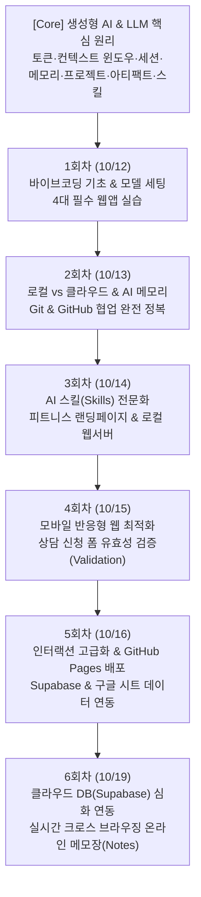
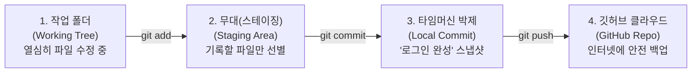
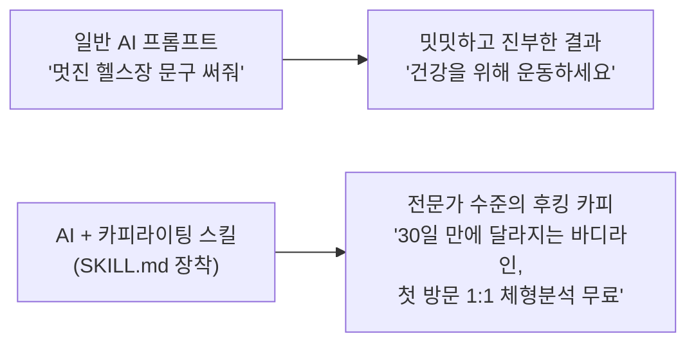
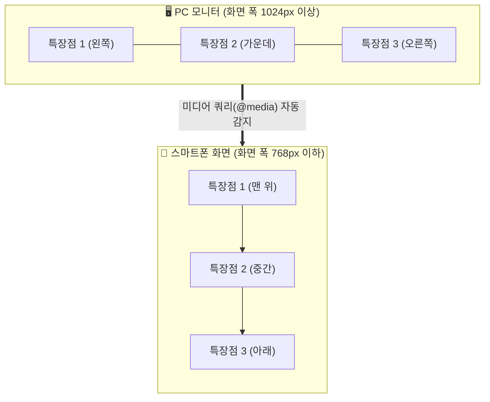
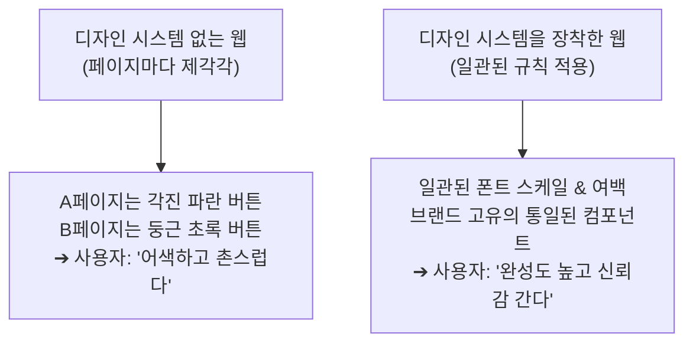
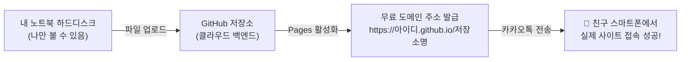
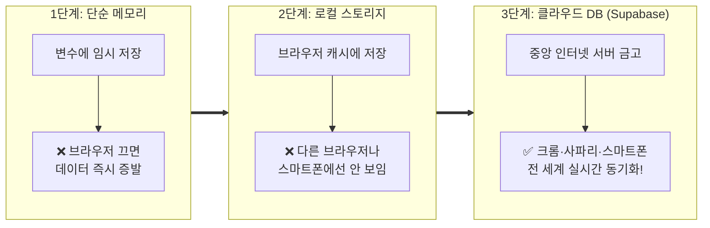
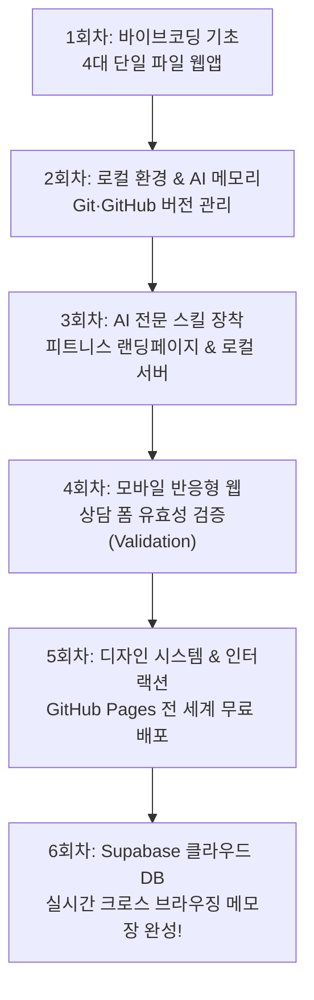
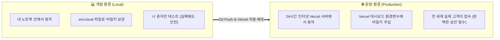
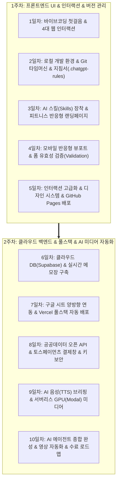

# 🚀 AI 바이브코딩 실무 2차 과정 완벽 실습 가이드북 

> **공식 교육 플랫폼**: [스터디 LMS (class.study.local/learn/ai-agent-course-2)](https://class.study.local/learn/ai-agent-course-2)  
> **과정명**: AI 바이브코딩 실무 양성과정 2차 · 코딩 없이 내 웹앱 만들기  
> **유튜브 플레이리스트**: [PLTeASr1UUXrs](https://www.youtube.com/playlist?list=PLTeASr1UUXrs)  
> **학습 대상**: 프로그래밍을 전혀 모르는 비전공자, 기획자, 마케터, 예비 창업자부터 실무 AI 에이전트와 웹앱을 직접 제작·배포하고 싶은 실무자까지  
> **작성 원칙**: 전문 개발 용어는 누구나 이해할 수 있는 일상 비유와 괄호 설명으로 풀었으며, 강의 영상이나 별도 교재 없이 이 가이드북만 보고도 100% 실습을 완료할 수 있도록 구성되었습니다.

---

## 📑 전체 교육 커리큘럼 한눈에 보기



---

## 🧠 [Core 기초] AI 핵심 원리 & 필수 개념 마스터

코딩 없이 AI와 성공적으로 협업하기 위해 반드시 알아야 할 9가지 핵심 원리입니다.

### 1. 생성형 AI와 LLM (대형 언어 모델)
* **생성형 AI (Generative AI)**: 기존 데이터를 분석만 하던 인공지능을 넘어, 텍스트·코드·이미지·영상 등 새로운 창작물을 직접 만들어내는 AI 기술.
* **LLM (Large Language Model)**: 수조 개의 인터넷 문장을 학습하여 인간의 말을 이해하고 다음 단어를 가장 자연스럽게 예측하여 답변을 작성하는 거대한 언어 두뇌.

### 2. 세션(Session)이란?
* **세션 (Session)**: 브라우저나 데스크톱 앱에서 AI와 주고받는 ‘하나의 대화 창(채팅방) 단위’.
* 채팅창을 새로 열면 새 세션이 시작되며, 기본적으로 각 세션은 서로 독립되어 이전 채팅방의 세부 대화가 섞이지 않습니다.

### 3. AI는 어떻게 앞 대화를 기억할까?
* AI는 사람처럼 뇌에 기억을 새겨두는 것이 아닙니다. 질문을 던질 때마다 **‘과거에 주고받은 대화 내역 전체를 이번 질문과 함께 한꺼번에 읽어들인 뒤’** 답변을 생성합니다.

### 4. 토큰 (Token) : AI가 글을 읽고 쓰는 단위
* **토큰 (Token)**: AI가 글을 이해하고 계산하는 최소 단위`(단어 또는 글자 조각)`. 영어는 대략 단어 하나당 1토큰, 한글은 글자 하나당 1~3토큰이 소모됩니다.
* **입력 토큰 vs 출력 토큰**:
  * *입력 토큰(Input Token)*: 내가 보낸 질문과 과거 대화 내역을 AI가 읽을 때 드는 비용/한도.
  * *출력 토큰(Output Token)*: AI가 화면에 코드를 타이핑하며 글을 출력할 때 드는 비용/한도.
* **토큰 쿼터(한도)**: ChatGPT Plus나 Claude Pro 같은 유료 플랜도 ‘3시간당 몇 회 질문/토큰 한도’가 정해져 있으므로, 코드를 생성할 때는 낭비 없이 핵심만 주고받아야 합니다.

### 5. 컨텍스트 윈도우 (Context Window)
* **컨텍스트 윈도우**: AI가 한 세션(대화방)에서 한꺼번에 머릿속에 담을 수 있는 ‘최대 읽기 용량(대화 기억 폭)’.
* **대화가 길어지면 앞부분을 놓치는 이유**: 대화가 책 수백 페이지 분량으로 길어져 컨텍스트 윈도우 한도를 넘어서면, AI는 가장 오래된 대화부터 잘라내거나 요약하여 기억하므로 초반에 내렸던 중요한 지시사항을 깜빡하게 됩니다.

### 6. 프로젝트 (Projects)와 아티팩트 (Artifacts)
* **프로젝트 (Project)**: 특정 목표(예: 빵집 창업 웹사이트)에 필요한 참고 문서, 가이드라인, 코드 파일들을 한곳에 묶어 보관하는 독립 작업 공간.
* **아티팩트 (Artifacts)**: 대화창 한구석에 코드가 파묻히지 않고, 화면 오른쪽에 독립된 창으로 깔끔하게 분리되어 실시간 웹 화면이나 긴 문서를 곧바로 렌더링해서 보여주는 전용 결과물 패널.

### 7. 사용자 지정 확장: 스킬(Skills), 커넥터(Connectors), 플러그인(Plugins)
* **스킬 (Skills)**: AI에게 전문 UI 디자이너나 전문 마케터처럼 일관된 작업 표준과 노하우를 주입하는 지침 모듈.
* **커넥터 (Connectors) & 플러그인 (Plugins)**: AI가 혼자 작업하는 것을 넘어, GitHub 저장소, 구글 드라이브, Notion, Supabase 같은 외부 인터넷 서비스와 직접 통신할 수 있도록 연결해 주는 다리.

### 8. 클라우드 컴퓨터 vs 내 컴퓨터 (로컬)
* **클라우드 (Cloud)**: 오픈AI나 앤스로픽 본사의 인터넷 서버. 브라우저에서만 대화하면 코드가 인터넷 화면에만 떠 있고 내 컴퓨터 하드디스크에는 저장되지 않습니다.
* **로컬 (Local)**: 내 눈앞의 노트북/데스크톱 본체. 내 컴퓨터 폴더에 저장해야 인터넷이 끊겨도 파일이 안전하게 보존되고 실제 소프트웨어로 구동됩니다.
* **왜 브라우저와 데스크톱 앱에서 같은 대화가 보일까?**: 모든 대화 텍스트가 중앙 클라우드 데이터베이스에 실시간 저장되어, 내 계정으로 로그인한 모든 기기(스마트폰, 앱, 웹 브라우저)에 1초 만에 동기화되기 때문입니다.

### 9. AI 도구의 진화 (챗 ➔ 코드 ➔ 코워크)
* 초기에는 단순 질문답변용 **챗(Chat)**이었으나, 점차 내 컴퓨터 폴더의 파일을 직접 만들고 수정하는 **코드/코덱스(Codex)** 모드로 발전하였으며, 현재는 여러 AI 에이전트와 도구가 유기적으로 협업하는 **코워크(Co-work)** 체제로 통합되고 있습니다.

---

---

## 📅 [1회차] 1회차 교육자료 AI 바이브코딩 기초 & 첫 웹앱 4대 필수 실습

# 📘 [1회차 교육자료] AI 바이브코딩 기초 & 첫 웹앱 4대 필수 실습

* **교육 과정**: AI 바이브코딩 실무 양성과정 2차 (코딩 없이 내 웹앱 만들기)
* **강의 일자**: 2026년 10월 12일
* **학습 목표**: 
  1. 바이브코딩의 기본 철학과 AI 에이전트 협업 방식을 이해한다.
  2. ChatGPT 데스크톱 앱을 설치하고, 비용과 이용 한도를 아끼는 최적의 모델(루나 Luna + 추론 High)을 세팅한다.
  3. 코드를 직접 치지 않고 자연어 프롬프트만으로 내 컴퓨터에서 실행되는 **4가지 단일 파일 웹앱**을 완성한다.

---

## 1. 강사 오리엔테이션 & 바이브코딩 핵심 철학

> 💡 **실전 핵심 조언**  
> *"개념만 잘 잡혀 있으면 트렌드는 다 똑같습니다. 요즘 뭐 새로운 툴이 나왔네 어쩌네 해도 기존 기술의 업그레이드일 뿐입니다. 하나의 툴(ChatGPT)을 제대로 다룰 줄 알면 클로드(Claude)든 커서(Cursor)든 너무 쉬워집니다. 중요한 건 평생 배울 수 없으니 스스로 문제를 해결하는 감각을 익히는 것입니다."*

### 💡 핵심 개념 1분 사전
* **바이브코딩 (Vibe Coding)**: 딱딱하고 복잡한 프로그래밍 문법을 암기하는 대신, 내가 원하는 화면의 느낌`(Vibe)`과 목적을 말하듯 AI에게 전달하여 프로그램을 완성하는 최신 개발 방식.
* **AI 에이전트 (AI Agent)**: 단순한 질문답변 챗봇을 넘어, 사용자가 내린 목표를 달성하기 위해 스스로 계획을 세우고 내 컴퓨터의 파일을 직접 열고 쓰며 코딩 작업을 대행해 주는 인공지능 비서.
* **인간의 디렉팅(체크)이 필요한 이유**: AI는 항상 100% 정답만 말하지 않습니다`(환각 현상 / Hallucination)`. 따라서 AI에게 작업을 완전히 방치하지 않고, 초보자라도 원하는 결과가 맞는지 브라우저를 열어 확인하고 지시를 보정하는 역할이 중요합니다.

---

## 2. 작업 환경 구축 & 토큰(비용)을 아끼는 모델 세팅 비법

> 💡 **실전 핵심 조언**  
> *"고성능 모델(o1, o3, 아스트라 등)이 똑똑하다고 무작정 쓰시면 안 됩니다. ChatGPT Plus(월 29,000원) 유료 계정도 3시간당 질문 횟수와 주간 토큰 사용 한도가 정해져 있습니다. 비싼 모델로 실습하다 보면 이틀 만에 일주일 치 이용 한도를 다 써버려서 3~4일 동안 작업을 아예 못 하게 됩니다. 그래서 우리는 똑똑하면서도 한도를 아낄 수 있는 '루나(Luna)' 모델을 주로 쓸 겁니다."*

### 🛠️ 실전 세팅 가이드
1. **브라우저 웹 vs 데스크톱 앱의 결정적 차이**:
   * *브라우저 웹(chatgpt.com)*: 코드가 인터넷 화면에만 떠 있어 창을 닫으면 내 컴퓨터에는 아무 파일도 남지 않습니다.
   * *데스크톱 앱(코덱스 Codex 모드)*: 데스크톱 앱을 열고 **[작업 폴더 열기 / Add Folder]**를 통해 내 컴퓨터 폴더를 연결하면, AI가 작성한 코드가 내 하드디스크에 실제 파일(`index.html`)로 실시간 저장됩니다.
2. **추천 모델 및 추론 강도 세팅**:
   * **모델 선택**: **루나 (Luna)**  
     *(비유: 갓 입사했지만 일머리가 뛰어난 '중고 신입' 같은 모델. 가성비가 매우 뛰어나며 빠른 속도로 웹 코드를 작성함)*
   * **추론 강도 (Reasoning Effort)**: **하이 (High)**  
     *(AI가 코드를 짜기 전에 문제를 한 단계 더 깊이 생각하고 검증하도록 설정)*

---

## 3. [1회차 4대 필수 실습] 단계별 완전 정복

### 🍞 실습 1. 내 컴퓨터에서 열리는 빵집 랜딩 페이지 (`index.html`)

#### 🎯 실습 목표
클릭 한 번으로 내 브라우저에서 바로 열리는 따뜻한 분위기의 빵집 홍보 페이지를 만들며, 프롬프트 한 문장으로 실제 웹사이트가 구축되는 바이브코딩의 기본 흐름을 체감합니다.

#### 🛠️ 단계별 따라 하기
1. 바탕화면에 `bakery`라는 이름의 빈 폴더를 만듭니다.
2. ChatGPT 데스크톱 앱에서 [Add Folder]를 눌러 방금 만든 `bakery` 폴더를 연결합니다.
3. 모델을 `Luna`, 추론 강도를 `High`로 맞춥니다.
4. 아래 프롬프트를 복사하여 전송합니다.
5. AI가 작업을 완료하면 폴더 안에 생성된 `index.html` 파일을 더블클릭합니다.
6. 크롬 브라우저에서 따뜻한 베이지 톤의 빵집 웹사이트가 정상 작동하는지 확인합니다.

#### 📋 복사해서 쓸 실전 프롬프트
```text
당신은 감성적인 웹 디자이너입니다.
단 하나의 파일(index.html)로 실행되는 따뜻한 동네 베이커리 '달콤한 오후'의 홍보 웹페이지를 만들어주세요.

[디자인 요구사항]
- 베이지와 브라운 톤의 부드럽고 따뜻한 색감
- 상단 내비게이션 바(홈, 대표 메뉴, 매장 위치)
- 대표 빵 3가지(크루아상, 소금빵, 바게트) 카드 섹션 및 가격 안내

[기술 제약조건]
- 별도의 패키지나 프로그램 설치 없이, 파일 더블클릭만으로 크롬 브라우저에서 바로 열리도록 완성된 코드를 index.html 단일 파일로 저장해주세요.
```

---

### 🎮 실습 2. 주석으로 한 가지 이상 바꾼 나만의 게임

#### 🎯 실습 목표
코드를 처음부터 짤 줄 몰라도, AI에게 **초보자용 안내 설명글`(주석, Comments)`**을 달아달라고 요청하면 메모장으로 열어 숫자 하나만 고치는 것만으로 나만의 게임 규칙을 만들 수 있음을 배웁니다.

#### 💡 용어 사전
* **주석 (Comments)**: 컴퓨터는 실행하지 않고 무시하지만, 코드를 읽는 사람을 위해 작성해 두는 친절한 한글 메모(`// 설명` 또는 `/* 설명 */`).

#### 🛠️ 단계별 따라 하기
1. 바탕화면에 새 폴더 `my-game`을 만들고 ChatGPT 데스크톱 앱에 연결합니다.
2. 아래 프롬프트를 전송하여 미니게임을 생성합니다.
3. 생성된 `index.html` 파일을 마우스 우클릭 ➔ **[연결 프로그램] ➔ [메모장]**(맥은 텍스트 편집기)으로 엽니다.
4. 코드 맨 위에 작성된 `// [초보자 수정 포인트]`를 찾습니다:
   * 공 속도: `SPEED = 5` ➔ `SPEED = 10` (두 배 빠르게!)
   * 막대기 크기: `PADDLE_WIDTH = 100` ➔ `PADDLE_WIDTH = 180` (쉬운 모드!)
   * 목숨 개수: `LIVES = 3` ➔ `LIVES = 5`
5. `Ctrl + S`(맥은 `Cmd + S`)로 저장한 뒤, 브라우저에서 새로고침(`F5`)을 눌러 변경된 규칙으로 플레이해 봅니다.

#### 📋 복사해서 쓸 실전 프롬프트
```text
브라우저에서 바로 마우스나 방향키로 즐길 수 있는 미니 게임(벽돌깨기 또는 장애물 피하기)을 index.html 단일 파일로 만들어주세요.

[핵심 요구사항]
코딩을 전혀 모르는 초보자가 메모장으로 코드를 열어서 게임 룰을 쉽게 바꿀 수 있도록, 코드 최상단에 아래와 같이 명확한 한글 수정 가이드 주석을 달아주세요:

// ==========================================
// [초보자 룰 수정 가이드] 숫자를 바꾸고 저장하세요!
// 1. 공 이동 속도 조절 (기본 5, 빠름 10): const BALL_SPEED = 5;
// 2. 플레이어 패들 가로 크기 (기본 100): const PADDLE_WIDTH = 100;
// 3. 시작 목숨 개수: const INITIAL_LIVES = 3;
// ==========================================
```

---

### 🪐 실습 3. 마우스로 돌려볼 수 있는 3D 태양계

#### 🎯 실습 목표
3차원 그래픽 수학 공식을 몰라도, 전문 그래픽 도구`(Three.js)`를 **CDN`(인터넷 링크로 부품 빌려오기)`** 방식으로 연동하여 마우스 360도 회전과 확대/축소가 가능한 3D 가상 우주를 구현합니다.

#### 💡 용어 사전
* **Three.js**: 웹 브라우저 안에서 화려한 3D 입체 그래픽을 그려주는 전 세계 표준 무료 그래픽 도구.
* **CDN (콘텐츠 전송 네트워크)**: 복잡한 다운로드/설치 없이, 코드에 링크 한 줄만 넣으면 인터넷에서 프로그램을 즉시 불러와 작동시키는 편리한 연결 방식.
* **OrbitControls**: 마우스 좌클릭 드래그로 화면 시점을 360도 회전시키고, 마우스 휠로 줌인/줌아웃을 가능하게 해주는 3D 카메라 컨트롤러.

#### 🛠️ 단계별 따라 하기
1. 바탕화면에 새 폴더 `solar-system`을 만들고 데스크톱 앱에 연결합니다.
2. 아래 프롬프트를 전송합니다.
3. 생성된 `index.html`을 브라우저로 열고, 화면을 마우스로 자유롭게 드래그하며 행성들의 자전과 공전을 감상합니다.

#### 📋 복사해서 쓸 실전 프롬프트
```text
Three.js CDN 라이브러리를 사용해서, 브라우저 화면 가득 마우스로 360도 자유롭게 돌려보고(OrbitControls) 휠로 줌인/아웃할 수 있는 '3D 태양계 시뮬레이션'을 index.html 단일 파일로 만들어주세요.

[구현 요소]
1. 중앙에서 환하게 빛나는 태양(Sun) 메쉬 구현
2. 태양 주위를 도는 행성들(수성, 금성, 지구, 화성, 목성, 토성)의 고유한 크기와 색상 표현
3. 실제처럼 행성들이 스스로 회전(자전)하고 태양 주위를 회전(공전)하는 애니메이션 프레임 구현
4. 우주 배경에 반짝이는 별빛 파티클 효과 추가
5. 파일 더블클릭만으로 크롬에서 즉시 3D 화면이 렌더링되도록 해주세요.
```

---

### ✋ 실습 4. 손가락으로 허공에 그린 그림 (`허공그림.png`)

#### 🎯 실습 목표
키보드와 마우스를 벗어나, 구글의 최첨단 비전 AI 모델`(MediaPipe Hands)`을 연동하여 웹캠에 비친 내 검지손가락 끝의 궤적으로 허공에 그림을 그리고 이미지 파일로 저장하는 인공지능 인터랙션을 완성합니다.

#### 💡 용어 사전
* **구글 MediaPipe Hands**: 일반 웹캠 영상에서 사람 손의 21개 관절 위치를 1초에 30번 이상 초정밀 계산해 내는 구글의 무료 인공지능 모델.
* **8번 랜드마크**: MediaPipe가 인식하는 손 관절 중 **'검지손가락 끝(Index Finger Tip)'**을 가리키는 고유 번호.

#### 🛠️ 단계별 따라 하기
1. 바탕화면에 새 폴더 `air-drawing`을 만들고 데스크톱 앱에 연결합니다.
2. 아래 프롬프트를 전송합니다.
3. 생성된 `index.html`을 브라우저로 열고, 주소창 상단에 뜨는 **[카메라 권한 허용]** 팝업을 클릭합니다.
4. 웹캠 앞에 손을 들고 검지손가락을 세워 허공에 글씨나 그림을 그립니다.
5. 화면의 색상 팔레트와 굵기 슬라이더를 조절해 봅니다.
6. 오른쪽의 **[그림 저장하기]** 버튼을 눌러 내 컴퓨터에 `허공그림.png` 파일로 다운로드합니다.

#### 📋 복사해서 쓸 실전 프롬프트
```text
웹캠을 통해 사용자의 손동작을 실시간 인식해서 허공에 그림을 그릴 수 있는 인터랙티브 웹앱을 index.html 단일 파일로 만들어주세요.

[인공지능 모델]
- 구글 MediaPipe Hands 라이브러리(CDN) 사용

[기능 요구사항]
1. 웹캠 영상에서 사용자의 손가락 관절을 추적하고, 특히 '8번 랜드마크(검지손가락 끝)'의 이동 궤적을 캔버스 위에 부드러운 선으로 그려주세요.
2. 화면 상단에 [선 색상 변경(빨/파/초/검)], [선 굵기 조절], [캔버스 전체 지우기] 버튼을 배치해주세요.
3. 내가 허공에 그린 그림만 깔끔하게 이미지 파일로 저장할 수 있는 [허공그림.png 다운로드] 버튼을 만들어주세요.
4. 웹캠이 없는 환경이거나 권한이 차단되었을 때 당황하지 않도록 친절한 한글 안내 메시지를 화면에 띄워주세요.
```

---

## 4. 1회차 마무리 & 2회차(Git & AI 메모리) 예고

> 💡 **실전 핵심 조언**  
> *"오늘 작업한 폴더를 다른 컴퓨터로 가져가서 작업하고 싶을 때, 단순히 USB에 담아가면 지금까지 나눈 '세션(대화 맥락)'이 끊겨버립니다. 집에서 AI에게 주의시켰던 지침들을 다른 컴퓨터의 AI는 모르기 때문이죠. 그래서 우리는 내일(2회차) AI에게 프로젝트 규칙을 기억시키는 방법과, 인터넷 클라우드에 내 코드를 타임머신처럼 안전하게 백업하고 복원하는 '깃(Git)과 깃허브(GitHub)'를 배울 것입니다."*

### 📌 1회차 핵심 체크리스트
* [ ] ChatGPT 데스크톱 앱에서 로컬 폴더를 연결할 수 있는가?
* [ ] 루나(Luna) 모델과 추론 High 조합으로 토큰 한도를 아낄 수 있는가?
* [ ] 빵집 홍보 페이지(`index.html`)가 브라우저 더블클릭으로 열리는가?
* [ ] 메모장으로 열어 주석의 숫자를 수정하고 새로고침하여 바뀐 룰을 확인했는가?
* [ ] Three.js 3D 태양계 화면을 마우스로 360도 회전시켜 보았는가?
* [ ] 웹캠 허공 드로잉을 통해 `허공그림.png` 파일을 다운로드했는가?

---

이 내용을 바탕으로 교재나 슬라이드 자료를 구성하시면, 수강생들이 배경 원리부터 실습까지 막힘없이 완벽하게 학습할 수 있습니다. 

확인 후 **2회차(로컬 환경 & AI 메모리 & Git·GitHub 완전 정복)** 내용도 이어서 자세히 정리해 드릴까요?

---

## 📅 [2회차] 2회차 교육자료 로컬 vs 클라우드 & AI 메모리 전략 & Git·GitHub 완전 정복

# 📘 [2회차 교육자료] 로컬 vs 클라우드 & AI 메모리 전략 & Git·GitHub 완전 정복

* **교육 과정**: AI 바이브코딩 실무 양성과정 2차 (코딩 없이 내 웹앱 만들기)
* **강의 일자**: 2026년 10월 13일
* **학습 목표**: 
  1. 생성형 AI가 답변을 작성하는 예측 원리와 3대 작업 인터페이스(챗, 워크, 코덱스)의 차이를 이해한다.
  2. AI 메모리의 작동 원리('공용 냉장고' 비유)를 파악하고, 불필요한 기억을 청소하여 코딩 집중도를 높인다.
  3. 대화가 길어져도 앞선 내용을 잊지 않도록 세션(Session) 분리 원칙과 프로젝트 규칙(`.chatgpt-rules`)을 수립한다.
  4. 깃(Git)과 깃허브(GitHub)의 개념을 이해하고, AI에게 스테이징·커밋·브랜치·병합 작업을 직접 지시해 본다.

---

## 1. 생성형 AI의 본질과 3대 작업 환경 (챗 vs 워크 vs 코덱스)

> 💡 **실전 핵심 조언**  
> *"AI에게 '서울은 대한민국의...' 하고 물어보면 '수도'라고 대답하죠? AI가 진짜 생각을 해서 아는 게 아닙니다. 수많은 데이터 패턴을 봤을 때 '수도'라는 단어가 올 확률이 가장 높다고 예측해서 내놓는 겁니다. 그래서 AI의 말은 항상 옳을 수 없고 사람이 확인해야 합니다. 그리고 ChatGPT 안에서도 일반 대화용 '챗', 문서/기획용 '워크', 코딩 폴더 연동용 '코덱스'의 세 가지 환경을 목적에 맞게 골라 쓸 줄 알아야 합니다."*

### 💡 3대 작업 인터페이스 비교
| 인터페이스 | 주요 대상 | 핵심 용도 및 특징 |
| :--- | :--- | :--- |
| **챗 (Chat)** | 모든 일반 사용자 | 일상적인 대화, 아이디어 브레인스토밍, 단순 질문답변 |
| **워크 (Work / Canvas)** | 비개발자 업무 실무자 | 보고서 작성, 슬라이드 초안, 엑셀 표 편집 등 문서를 화면 옆에 띄워두고 AI와 함께 수정하는 협업 모드 |
| **코덱스 (Codex)** | 바이브코딩 & 개발 실무자 | **내 컴퓨터의 로컬 폴더를 직접 연결**하여 실제 파일(`index.html`)을 만들고 수정하는 전용 모드 |

---

## 2. AI 메모리의 빛과 그림자 (공용 냉장고 비유)

> 💡 **실전 핵심 조언**  
> *"메모리는 회사 탕비실의 '공용 냉장고'와 같습니다. 내가 사과를 냉장고에 넣어두면, 내가 그 방을 나가거나 대화창을 삭제해도 냉장고 안에 사과는 그대로 남아 있습니다. 문제는 불필요한 잡담(예: 오늘 날씨 흐리네, 점심 뭐 먹지)까지 냉장고에 꽉 차 있으면, 나중에 빵집 코딩을 시킬 때 AI가 엉뚱하게 그 잡담을 꺼내와서 대화가 삼천포로 빠집니다. 메모리는 무조건 쌓아두는 게 능사가 아닙니다. 정기적으로 청소해야 합니다."*

### 💡 용어 사전
* **전역 메모리 (Global Memory)**: 사용자가 여러 대화방에서 나눈 정보 중 AI가 "이건 기억해둬야겠다"고 판단하여 계정 전체에 저장해 두는 장기 기억장치.
* **메모리 오염 (Memory Poisoning)**: 코딩과 상관없는 과거의 잡담이나 오래된 조건이 메모리에 남아, 새로운 코딩 작업을 할 때 엉뚱한 코드를 생성하거나 간섭하는 현상.

---

## 3. 세션(Session) 분리와 카톡방 비유

> 💡 **실전 핵심 조언**  
> *"여러분 단톡방에서 대화가 수천 개씩 쌓이면 위로 스크롤 올려도 '아까 그 얘기 어디 있었지?' 하고 못 찾잖아요? AI도 똑같습니다. 대화가 너무 길어지면(컨텍스트 윈도우 한도 초과) 분명히 앞에서 말했던 중요한 규칙도 까먹고 엉뚱한 소리를 합니다. 사람과 일할 때처럼 세션을 지혜롭게 나눠야 합니다."*

### 📌 강사가 제시한 세션 분리의 2대 황금 원칙
1. **같은 세션을 유지해야 하는 경우**:
   * 방금 만든 빵집 사이트의 버튼 색을 바꾸거나, 글자 크기를 키우는 등 **기존 작업물을 조금씩 보완하고 수정할 때**.
2. **반드시 새 세션(새 채팅방)을 열어야 하는 경우**:
   * 빵집 사이트 작업이 끝나고 **새로운 게임이나 3D 태양계 등 완전히 다른 주제로 넘어갈 때**.
   * 대화가 너무 길어져서 AI가 방금 말한 규칙을 자꾸 까먹기 시작할 때.

---

## 4. [실습 1] 메모리 청소 & 프로젝트 기본 지침서(`.chatgpt-rules`) 구축

### 🎯 실습 목표
ChatGPT 설정에서 과거 불필요한 기억을 삭제하고, 앞으로 작업할 프로젝트 폴더에 AI가 무조건 지켜야 할 나만의 원칙을 주입합니다.

### 🛠️ 단계별 따라 하기
1. ChatGPT 데스크톱 앱 우측 상단 프로필 클릭 ➔ **[설정(Settings)]** ➔ **[개인화(Personalization)]**로 이동합니다.
2. **[메모리 관리(Manage Memory)]**를 클릭하여 열람합니다.
3. 코딩 작업과 무관한 일상 잡담(날씨, 음식 취향 등) 옆의 휴지통 아이콘을 눌러 **삭제(Delete)**합니다.
4. 작업 폴더를 열고, 프롬프트 창에 아래 지침을 전송하여 프로젝트 전용 규칙을 심어줍니다.

### 📋 복사해서 쓸 실전 프롬프트
```text
앞으로 이 프로젝트 폴더 안에서 작업할 때는 다음 원칙을 항상 기본 지침으로 준수해주세요:

1. [초보자 배려] 코딩을 모르는 사용자도 코드를 이해할 수 있도록 중요한 기능과 변수마다 친절한 한글 주석(//)을 달아주세요.
2. [단일 파일 원칙] 별도의 복잡한 설치나 빌드 과정 없이, 브라우저 더블클릭만으로 즉시 열리는 단일 HTML 파일(index.html) 구조를 유지해주세요.
3. [디자인 표준] 스타일은 깔끔하고 모던한 Tailwind CSS(CDN)를 기본으로 적용해주세요.
4. [수정 가이드] 사용자가 설정을 바꿀 수 있는 부분(색상, 속도, 크기 등)은 코드 최상단에 수정 포인트를 명시해주세요.

이 내용을 이 프로젝트의 영구 작업 지침으로 기억하고 코딩을 진행해주세요.
```

---

## 5. 깃(Git)과 깃허브(GitHub) 완전 정복 (실무 커리큘럼)

> 💡 **실전 핵심 조언**  
> *"오늘 작업한 소스코드를 USB에 담아 다른 컴퓨터로 가져가면 지금까지 AI와 나눈 대화 맥락이 끊겨버립니다. 그래서 개발자들은 '깃(Git)'이라는 타임머신 장부와, 인터넷에 안전하게 올려두는 '깃허브(GitHub)'라는 거대한 클라우드 창고를 사용합니다."*

### 💡 핵심 개념 1분 사전
* **Git (깃)**: 내 컴퓨터 안에서 코드의 변경 내역을 한 땀 한 땀 기록하여, 언제든 과거의 특정 시점으로 되돌아갈 수 있게 해주는 **타임머신 버전 관리 시스템**.
* **GitHub (깃허브)**: Git으로 기록한 프로젝트를 인터넷에 올려 전 세계 사람들과 공유하고 협업할 수 있는 **온라인 클라우드 저장소(Repository)**.
* **저장소 (Repository / 줄여서 Repo)**: 프로젝트의 모든 파일과 변경 이력 장부가 보관되는 프로젝트의 전용 방. (Public: 전 세계 공개 / Private: 나만 보기).



### 💡 Git 3단계 작업 흐름의 이해
1. **작업 폴더 (Working Tree)**: 지금 내가 메모장이나 코덱스로 파일을 수정하고 있는 내 눈앞의 폴더.
2. **스테이징 (Staging Area)**: 이번에 기록으로 남길 파일들만 골라서 무대(Stage) 위에 올려놓는 준비 작업 (`git add`).
3. **커밋 (Commit)**: 무대에 오른 파일들의 상태를 "00기능 추가 완료"라는 설명 라벨과 함께 영구히 박제하는 타임머신 스냅샷 (`git commit`).

### 💡 협업을 위한 브랜치(Branch)와 병합(Merge)
* **브랜치 (Branch / 나뭇가지)**: 잘 돌아가고 있는 메인 줄기(`main`)를 건드리지 않고, 위험한 새 기능(예: 다크모드)을 안전하게 시험해 보기 위해 옆으로 뻗어 나오는 독립된 작업 공간.
* **병합 (Merge)**: 브랜치에서 실험이 성공적으로 끝나면, 메인 줄기(`main`)에 합쳐서 정식 기능으로 채택하는 과정.

### 💡 깃허브 5대 협업 도구의 문제 해결 역할
* **README.md**: 이 프로젝트가 무엇인지 처음 온 사람에게 알려주는 **대문 설명서**.
* **Issues (이슈)**: "로그인이 안 돼요", "버튼 색 바꿔주세요"처럼 버그나 할 일을 등록하는 **작업 티켓**.
* **Projects (프로젝트 보드)**: 할 일(To-do), 진행 중(In Progress), 완료(Done)를 한눈에 보는 **칸반 보드**.
* **Pull Request (PR)**: "내가 브랜치에서 새 기능을 다 만들었으니 원본에 합쳐주세요"라고 동료에게 검토를 요청하는 **병합 제안서**.
* **GitHub Actions**: 코드가 올라오면 스스로 테스트를 돌리고 배포까지 해주는 **자동화 로봇**.

---

## 6. [실습 2 & 3] AI에게 Git 맡기기 (명령어를 외우지 않는 바이브코딩)

### 🛠️ 실습 2. AI에게 Git 저장소 초기화 & 첫 커밋 지시하기
* **목표**: 터미널 명령어를 일일이 외우지 않고, AI에게 자연어로 Git 버전 관리를 시작하도록 요청합니다.
* **실전 프롬프트**:
```text
현재 작업 폴더에서 Git 버전 관리를 시작하고 싶습니다.

1. 현재 폴더에 Git 저장소를 초기화(git init)해주세요.
2. 초보자를 위해 이 프로젝트가 무엇인지 설명하는 친절한 README.md 문서를 작성해주세요.
3. 모든 파일을 스테이징(git add .)하고, 첫 번째 커밋("feat: 프로젝트 초기화 및 기본 웹페이지 생성")을 작성해주세요.
4. 방금 작성된 깃 로그(git log) 상태를 초보자가 알아보기 쉽게 한글로 요약해서 설명해주세요.
```

---

### 🛠️ 실습 3. 기능 브랜치 생성 및 안전한 병합(Merge) 지시하기
* **목표**: 메인 코드를 안전하게 보호하면서, 새로운 디자인을 시험하고 합치는 브랜치 워크플로우를 체득합니다.
* **실전 프롬프트**:
```text
기존 메인 코드를 망치지 않고 새로운 디자인을 안전하게 시험해보고 싶습니다:

1. 'feature/dark-mode'라는 이름의 새로운 브랜치를 만들고 거기로 이동해주세요.
2. 웹페이지의 배경을 세련된 다크 모드로 변경한 뒤, 원본과 무엇이 바뀌었는지 변경점(diff)을 보여주세요.
3. 변경 사항을 'feat: 다크모드 디자인 추가'라는 메시지로 커밋해주세요.
4. 다시 메인(main) 브랜치로 돌아와서 방금 작업한 다크모드 브랜치를 안전하게 병합(merge)해주세요.
```

---

## 7. 2회차 핵심 요약 & 3회차(스킬 장착 & 랜딩페이지) 예고

### 📌 2회차 핵심 체크리스트
* [ ] ChatGPT 메모리 관리 메뉴에서 불필요한 잡담 기억을 삭제했는가?
* [ ] 프로젝트 폴더에 `.chatgpt-rules` 원칙을 전달하여 일관된 코딩을 유도했는가?
* [ ] 가벼운 수정은 같은 세션에서 하고, 새 주제는 새 세션을 파야 하는 이유를 이해했는가?
* [ ] 작업 폴더 ➔ 스테이징 ➔ 커밋으로 이어지는 Git의 3단계 흐름을 이해했는가?
* [ ] 브랜치를 만들어 원본 훼손 없이 안전하게 기능을 실험하고 병합해 보았는가?

> 🚀 **3회차 예고**:  
> 내일 3회차에서는 AI에게 전문 UI 디자이너와 마케팅 카피라이터의 페르소나를 부여하는 **'스킬(Skills)' 장착법**을 배우고, 실제 고객의 결제와 상담 신청을 이끌어내는 고품질 **피트니스 클럽 랜딩페이지**를 제작해 봅니다!

---

2회차 교육자료 확인 후, 이어서 **3회차(AI 스킬 장착 & 피트니스 랜딩페이지 & 로컬 웹서버)** 내용도 바로 정리해 드릴까요?

---

## 📅 [3회차] 3회차 교육자료 AI 스킬(Skills) 전문화 & 피트니스 랜딩페이지 & 로컬 웹 서버

# 📘 [3회차 교육자료] AI 스킬(Skills) 전문화 & 피트니스 랜딩페이지 & 로컬 웹 서버

* **교육 과정**: AI 바이브코딩 실무 양성과정 2차 (코딩 없이 내 웹앱 만들기)
* **강의 일자**: 2026년 10월 14일
* **학습 목표**: 
  1. 기획부터 배포까지 속도를 극대화하는 **MVP (최소 기능 제품)** 전략을 습득한다.
  2. AI 에이전트에게 전문적인 작업 레시피를 장착시키는 **스킬 (Skills)**의 개념과 작동 원리를 이해한다.
  3. 피트니스 클럽 랜딩페이지를 제작하고, **카피라이팅(Copywriting) 스킬**을 주입하여 고객 유치 문구를 고도화한다.
  4. 단순 파일 열기(`file://`)와 **로컬 정적 웹 서버(`http://localhost`)**의 차이를 이해하고 내 컴퓨터에 간이 서버를 띄워본다.

---

## 1. MVP(최소 기능 제품) 사고방식 & AI 업무 위임의 원칙

> 💡 **실전 핵심 조언**  
> *"처음부터 결제 시스템, 복잡한 회원가입, 화려한 관리자 화면 10가지를 다 하려고 하면 백퍼센트 망합니다. 한 가지 핵심 가치에 집중해야 합니다. 내가 헬스장을 운영하는데 종이 전단지만 돌리기 아쉬워서 온라인에 우리 헬스장 장점을 알리고 상담 신청을 받아 고객 전화번호를 모으는 것! 딱 이 '상담 신청 확보' 하나에만 집중해서 가장 작게 빠르게 만드는 것, 이게 바로 MVP입니다."*

### 💡 용어 사전
* **MVP (Minimum Viable Product, 최소 기능 제품)**: 고객이 우리 서비스를 이용하는 데 꼭 필요한 '핵심 기능 딱 한 가지'만 갖추어 가장 빠르고 저렴하게 세상에 내놓는 시제품.
* **랜딩 페이지 (Landing Page)**: 온라인 광고나 링크를 누른 고객이 가장 먼저 착륙`(Landing)`하여, 스크롤을 내리며 매력을 느끼고 최종적으로 '상담 신청'이나 '구매' 버튼을 누르도록 설계된 1페이지짜리 웹사이트.

---

## 2. AI 스킬(Skills)이란 무엇인가? (전문가 레시피 모듈)

> 💡 **실전 핵심 조언**  
> *"AI한테 '세련되게 만들어줘', '멋있게 써줘'라고 하면 너무 막연하죠. 사람은 저마다 '세련됨'의 기준이 다르니까요. 그래서 우리는 AI에게 전문가의 비법 매뉴얼인 '스킬(Skill)'을 쥐어주는 겁니다. 스마트폰에 앱을 깔듯이 카피라이팅 스킬, UI 디자인 스킬, 영수증 정리 스킬을 AI에게 꽂아주면 AI가 그 매뉴얼에 적힌 규칙대로 전문가 수준의 결과물을 뽑아냅니다."*



### 💡 스킬(Skills) 핵심 개념 정리
* **스킬 (Skill)**: AI 에이전트가 특정 전문 작업을 수행할 때 따라야 할 절차, 제약조건, 베스트 프랙티스가 적힌 **표준 작업 매뉴얼(`SKILL.md`)**.
* **스킬의 구성 요소**:
  * **메타데이터 (Name, Description)**: 이 스킬이 어떤 상황에서 호출되어야 하는지 알려주는 이름표.
  * **레시피 (Body/Instructions)**: AI가 따라야 할 구체적인 규칙 (예: "헤드라인은 15자 이내로 작성할 것", "숫자와 혜택을 반드시 포함할 것").
* **전역 스킬(Global) vs 프로젝트 스킬(Project)**:
  * *전역 스킬*: 내 컴퓨터의 모든 폴더에서 언제든 슬래시(`/`) 명령어로 불러 쓸 수 있는 공용 도구.
  * *프로젝트 스킬*: 해당 프로젝트 폴더 안에서만 작동하도록 격리된 맞춤형 도구.

---

## 3. [실습 1] 피트니스 클럽 MVP 랜딩페이지 제작

### 🎯 실습 목표
방문자의 시선을 단번에 사로잡는 모던 다크 모드 스타일의 피트니스 센터 랜딩페이지를 단일 파일(`index.html`)로 제작합니다.

### 🛠️ 단계별 따라 하기
1. 바탕화면에 새 폴더 `fitness-club`을 만들고 ChatGPT 데스크톱 앱(Codex 모드)으로 연결합니다.
2. 모델을 `Luna`, 추론 강도를 `High`로 설정합니다.
3. 아래 실전 프롬프트를 전송합니다.
4. 폴더에 생성된 `index.html` 파일을 더블클릭하여 크롬 브라우저에서 디자인과 레이아웃을 확인합니다.

### 📋 복사해서 쓸 실전 프롬프트
```text
당신은 최고급 프리미엄 피트니스 클럽의 수석 마케터이자 UI 디자이너입니다.
신규 회원의 상담 신청을 유도하기 위한 모던한 헬스장 랜딩페이지를 index.html 단일 파일로 만들어주세요.

[디자인 컨셉]
- 강렬하고 트렌디한 다크 모드 (배경: 블랙/다크 그레이, 포인트 컬러: 형광 네온 라임 또는 일렉트릭 블루)
- 폰트: 깔끔하고 가독성 높은 산세리프(Pretendard 등) 스타일 적용

[핵심 섹션 구성]
1. 히어로 섹션: 시선을 사로잡는 메인 헤드카피와 배경 이미지, [1회 무료 체험 신청] CTA 버튼
2. 특장점 3종 카드: 최고급 머신 구비, 1:1 맞춤 체형분석, 프라이빗 샤워룸
3. 트레이너 프로필: 전문 자격 및 경력이 돋보이는 트레이너 2인의 프로필 카드
4. 상담 신청 폼: 이름, 전화번호, 희망 방문시간 입력란 및 [상담 예약하기] 제출 버튼

[기술 제약조건]
- 별도 설치 없이 Tailwind CSS CDN을 활용해 파일 하나로 즉시 실행되게 해주세요.
```

---

## 4. [실습 2] 카피라이팅(Copywriting) 스킬 주입 & 문구 업그레이드

### 🎯 실습 목표
밋밋하고 뻔한 문구를 전문 광고 카피라이팅 공식(AIDA 공식: 주의 ➔ 흥미 ➔ 욕구 ➔ 행동)을 적용한 후킹 멘트로 전면 리팩토링합니다.

> 💡 **실전 핵심 조언**  
> *"웹사이트 디자인이 아무리 예뻐도 문구가 '헬스장입니다. 운동하러 오세요' 수준이면 고객은 3초 만에 이탈합니다. 카피라이팅 스킬을 써서 고객이 겪고 있는 고통(다이어트 실패, 바쁜 직장인의 체력 저하)을 콕 찔러주고, 무료 체험이라는 확실한 혜택을 제시해야 신청 버튼을 누릅니다."*

### 💡 카피 전후 비교 (Before & After)
* **수정 전 (기본 AI)**: "최고의 트레이너와 함께 건강한 몸을 만드세요."
* **수정 후 (스킬 적용)**: **"혼자 하는 운동은 이제 그만. 30일 만에 옷핏이 바뀌는 1:1 밀착 트레이닝 (선착순 체형분석 무료)"**

### 📋 복사해서 쓸 실전 프롬프트
```text
전문 '카피라이팅(Copywriting) 스킬'을 발휘하여, 현재 피트니스 랜딩페이지의 모든 문구를 고객의 행동을 유도하는 매력적인 문장으로 전면 수정해주세요:

1. [메인 헤드라인]
- 고객의 결핍과 목표를 직접 건드리는 강력한 후킹 카피로 변경해주세요. (예: "당신의 한계를 넘어서는 1:1 맞춤 케어")
- 소제목에는 구체적인 숫자(30일, 98% 만족도 등)를 넣어 신뢰도를 높여주세요.

2. [CTA(Call to Action) 버튼]
- 단순한 '신청하기' 대신 '지금 무료 체험 신청하기 (선착순 10명)'처럼 행동을 자극하는 문구로 바꿔주세요.

3. [상담 폼 안내 문구]
- "상담 신청 시 5만 원 상당의 인바디 & 체형분석 리포트를 무료로 제공해 드립니다"라는 혜택 문구를 폼 상단에 강조해주세요.
```

---

## 5. [실습 3] 로컬 정적 웹 서버(Local Web Server) 구동하기

### 🎯 실습 목표
단순히 파일을 마우스로 더블클릭해서 여는 방식(`file://`)과 실제 인터넷 환경과 동일한 **로컬 정적 웹 서버(`http://localhost`)**의 차이를 이해하고, 내 컴퓨터에 간이 방송국(웹 서버)을 실행해 봅니다.

### 💡 용어 사전
* **`file://` 프로토콜**: 내 컴퓨터 하드디스크의 경로를 브라우저가 직접 읽어오는 방식. 브라우저 보안 정책 때문에 카메라 권한이나 외부 데이터 연동 시 에러가 발생할 수 있음.
* **`http://localhost` (로컬 웹 서버)**: 내 컴퓨터 안에 작은 간이 웹서버(방송국)를 차려서, 실제 `www.naver.com` 같은 인터넷 서버에 접속한 것과 완전히 똑같은 환경을 가상으로 만들어주는 방식.

### 🛠️ 1초 만에 로컬 웹 서버 실행하는 법
터미널이나 명령 프롬프트(CMD)를 열고 내 프로젝트 폴더에서 아래 명령어 한 줄만 입력하면 웹 서버가 켜집니다:

```bash
# Python 3가 설치된 모든 컴퓨터에서 작동 (맥/윈도우 공통)
python3 -m http.server 8080
```
* 서버가 켜지면 크롬 주소창에 **`http://localhost:8080`**을 입력하고 엔터를 치면 내 사이트가 실제 웹 호스팅 서버처럼 안정적으로 작동합니다. (종료할 때는 터미널에서 `Ctrl + C`).

---

## 6. 3회차 핵심 요약 & 4회차(모바일 반응형 & 폼 검증) 예고

### 📌 3회차 핵심 체크리스트
* [ ] 10가지를 분산하지 않고 상담 신청 확보에 집중한 MVP 사이트를 기획했는가?
* [ ] AI에게 전문 레시피 매뉴얼인 '스킬(Skills)'을 주입하는 원리를 이해했는가?
* [ ] 다크 모드 피트니스 랜딩페이지에 카피라이팅 스킬을 적용하여 후킹 문구로 변경했는가?
* [ ] `file://` 파일 열기와 `http://localhost` 로컬 웹 서버 환경의 차이를 이해했는가?

> 📱 **4회차 예고**:  
> 내일 4회차에서는 요즘 웹 트래픽의 80% 이상을 차지하는 **스마트폰 모바일 반응형 웹(미디어 쿼리)**을 구축하고, 고객이 전화번호를 잘못 적었을 때 친절하게 경고창을 띄워주는 **폼 유효성 검사(Validation)**를 완성해 봅니다!

---

3회차 교육자료 확인 후, 이어서 **4회차(모바일 반응형 레이아웃 & 폼 유효성 검증)** 내용도 바로 정리해 드릴까요?

---

## 📅 [4회차] 4회차 교육자료 모바일 반응형 웹 최적화 & 상담 신청 폼 유효성 검증

# 📘 [4회차 교육자료] 모바일 반응형 웹 최적화 & 상담 신청 폼 유효성 검증

* **교육 과정**: AI 바이브코딩 실무 양성과정 2차 (코딩 없이 내 웹앱 만들기)
* **강의 일자**: 2026년 10월 15일
* **학습 목표**: 
  1. 전체 인터넷 트래픽의 80% 이상을 차지하는 **모바일 퍼스트(Mobile-First)** 관점을 이해한다.
  2. 기기 화면 크기에 따라 카드와 레이아웃이 자동으로 재배치되는 **미디어 쿼리(Media Query)** 반응형 원리를 습득한다.
  3. 스마트폰 실기기 없이도 PC 브라우저에서 모바일 화면을 검증하는 **개발자 도구(F12) 디바이스 툴바** 활용법을 익힌다.
  4. 고객이 실수로 연락처를 빼먹거나 잘못 적었을 때 안내창을 띄우는 **폼 유효성 검사(Validation)**를 완성한다.

---

## 1. 모바일 퍼스트(Mobile-First) 사고방식 & 반응형 웹의 원리

> 🗣️ **강사 실전 코멘트 요약**  
> *"초보자들이 가장 많이 하는 실수가 넓은 PC 모니터 화면만 보면서 '와 디자인 멋지다!' 하고 끝내는 겁니다. 하지만 실제 인스타그램 광고나 카카오톡 링크를 타고 들어오는 고객의 80~90%는 스마트폰으로 봅니다. PC에서 아무리 예뻐도 스마트폰 화면에서 글씨가 콩알만 해지거나 카드가 찌그러져 옆으로 삐져나가면 고객은 1초 만에 뒤로가기를 누릅니다."*



### 💡 핵심 개념 1분 사전
* **반응형 웹 (Responsive Web Design)**: 하나의 웹사이트가 PC 모니터, 아이패드(태블릿), 갤럭시/아이폰(스마트폰) 등 방문자의 기기 화면 크기를 감지하여 자동으로 글자 크기와 카드 배치를 딱 맞게 조절해 주는 기술.
* **미디어 쿼리 (Media Query)**: CSS 스타일시트 안에 *"만약 화면 폭이 768px 이하로 좁아지면 가로 3열 카드를 위아래 1단으로 쌓아라!"*라고 조건을 거는 화면 감지 센서 규칙(`@media (max-width: 768px)`).
* **터치 타깃 (Touch Target)**: 마우스 커서 대신 두꺼운 엄지손가락으로 버튼을 누르는 모바일 사용자를 위해, 버튼의 상하좌우 터치 면적을 최소 44px 이상 넓게 확보해 주는 모바일 UI 배려.

---

## 2. 브라우저 개발자 도구(F12) 모바일 디버깅 비법

스마트폰을 일일이 켜지 않고도 내 노트북 화면에서 즉시 아이폰이나 갤럭시 화면 크기로 테스트하는 방법입니다.

### 🛠️ 1초 만에 모바일 뷰로 전환하는 법
1. 크롬(Chrome) 브라우저에서 내 웹페이지를 엽니다.
2. 키보드 맨 위의 **`F12`** 키를 누릅니다 (맥북은 `Cmd + Option + I`).
   * ➔ 화면 오른쪽이나 아래에 개발자 도구 창이 열립니다.
3. 개발자 도구 좌측 상단에 있는 **스마트폰/태블릿 모양 아이콘 (Toggle Device Toolbar)**을 클릭합니다.
   * *(단축키: `Ctrl + Shift + M` / 맥은 `Cmd + Shift + M`)*
4. 브라우저 상단에서 **[Dimensions: Responsive]**를 눌러 **iPhone 14 Pro**나 **Galaxy S20**으로 선택해 봅니다.
5. 마우스 커서가 둥근 회색 원(손가락 터치 모양)으로 바뀌며, 실제 스마트폰에서 화면이 어떻게 보이고 스크롤되는지 완벽하게 시뮬레이션할 수 있습니다.

---

## 3. 폼 유효성 검사(Validation)의 필요성과 안전장치

> 🗣️ **강사 실전 코멘트 요약**  
> *"고객이 헬스장 상담 신청을 하려고 폼에 이름을 비워두고, 전화번호에 '123' 세 자리만 치고 [신청하기]를 눌렀는데 그대로 넘어가 버리면 어떻게 될까요? 사장님은 전화를 걸 번호가 없어서 귀중한 가망 고객 한 명을 영영 잃어버리게 됩니다. 잘못된 입력을 사전에 걸러주는 안전장치가 바로 '유효성 검사'입니다."*

### 💡 유효성 검사 3단계 흐름
1. **필수값 검사 (`required`)**: 이름과 연락처가 빈칸이거나 공백만 쳐져 있는지 확인.
2. **형식 검사 (정규 표현식 / Regex)**: 전화번호가 진짜 한국 휴대전화 번호 형태(`010-XXXX-XXXX` 또는 `010XXXXXXXX`)인지 숫자 개수와 패턴을 검사.
3. **사용자 피드백 (Error Feedback)**: 실수한 입력창 바로 밑에 붉은색 글씨로 *"올바른 휴대폰 번호 11자리를 입력해 주세요"*라고 친절히 안내하고, 정상 입력 시에만 녹색 성공 모달 창을 띄움.

---

## 4. [실습 1] 피트니스 랜딩페이지 모바일 반응형 전면 개조

### 🎯 실습 목표
3회차에 만들었던 `fitness-club` 프로젝트에 모바일 미디어 쿼리를 적용하여, 스마트폰 화면 크기에서도 글씨가 찌그러지지 않고 카드가 세로 1열로 시원하게 배치되도록 개선합니다.

### 🛠️ 단계별 따라 하기
1. 기존 `fitness-club` 폴더를 ChatGPT 데스크톱 앱(Codex 모드)으로 엽니다.
2. 아래 프롬프트를 전송합니다.
3. 수정된 `index.html`을 브라우저에서 열고, `F12`를 눌러 화면 가로 폭을 줄여보며 카드가 3열에서 1열로 자연스럽게 떨어지는지 확인합니다.

### 📋 복사해서 쓸 실전 프롬프트
```text
기존 피트니스 랜딩페이지를 스마트폰에서도 완벽하게 작동하도록 '모바일 반응형 최적화'를 적용해주세요:

[모바일 반응형 요구사항]
1. [그리드 레이아웃 자동 변환]
   - 화면 폭이 768px 이하(태블릿/스마트폰)로 줄어들면, 가로 3개로 나열된 [특장점 카드]와 [트레이너 카드]가 위아래 세로 1단으로 자연스럽게 떨어지도록 Tailwind CSS 반응형 클래스(grid-cols-1 md:grid-cols-3)를 적용해주세요.
2. [모바일 가독성]
   - 모바일 화면에서는 메인 헤드카피 글자 크기를 적절히 조절하여 줄바꿈이 어색하게 깨지지 않게 해주세요.
3. [손가락 터치 사용성]
   - 스마트폰 화면에서 엄지손가락으로 누르기 쉽도록 [상담 예약하기] 버튼과 모든 입력란(Input)의 상하 패딩(높이)을 충분히 키워주세요 (최소 높이 48px 이상).
```

---

## 5. [실습 2] 빈틈없는 상담 신청 폼 유효성 검증 시스템 구축

### 🎯 실습 목표
고객이 잘못된 전화번호를 입력하거나 필수 입력란을 빼먹었을 때 즉각적인 안내 메시지를 띄우고, 정상 입력 시 감성적인 접수 확인 팝업창을 띄웁니다.

### 🛠️ 단계별 따라 하기
1. 같은 세션에서 아래 프롬프트를 이어서 전송합니다.
2. 완성된 페이지에서 다음과 같이 테스트해 봅니다:
   * **테스트 A (빈칸)**: 아무것도 안 적고 [상담 예약하기] 클릭 ➔ *"이름을 입력해 주세요"* 경고 표시 확인.
   * **테스트 B (엉뚱한 번호)**: 전화번호에 `1234` 입력 후 클릭 ➔ *"010으로 시작하는 11자리 번호를 입력해 주세요"* 빨간 안내문 확인.
   * **테스트 C (정상 입력)**: 이름과 `010-1234-5678` 입력 후 클릭 ➔ 화면 중앙에 *"상담 예약이 성공적으로 접수되었습니다!"* 모달 팝업 확인.

### 📋 복사해서 쓸 실전 프롬프트
```text
피트니스 랜딩페이지 하단의 [상담 신청 폼]에 자바스크립트 '유효성 검사(Validation)' 안전장치를 완벽하게 구현해주세요:

[검증 세부 규칙]
1. [이름 검증]
   - 이름이 빈칸이면 입력창 테두리를 붉은색으로 바꾸고, 입력창 아래에 "성함을 입력해 주세요." 경고 문구를 띄워주세요.
2. [전화번호 검증]
   - 한국 휴대전화 정규식 패턴(/^01([0|1|6|7|8|9])-?([0-9]{3,4})-?([0-9]{4})$/)을 적용해주세요.
   - 번호가 맞지 않으면 "올바른 휴대전화 번호(010-XXXX-XXXX)를 입력해 주세요." 문구를 표시해주세요.
   - 숫자를 입력할 때 자동으로 하이픈(-)이 붙도록 편의 기능을 넣어주세요.
3. [정상 접수 피드백]
   - 모든 정보가 올바르게 입력된 상태에서 제출 버튼을 누르면:
     ① 버튼에 로딩 스피너 애니메이션 표시 (0.8초)
     ② 화면 중앙에 세련된 [접수 완료 모달(팝업)] 창 표시 ("신청이 완료되었습니다! 24시간 이내에 담당 트레이너가 연락드립니다.")
     ③ 입력 폼 필드를 깨끗하게 초기화(Reset)
```

---

## 6. 4회차 핵심 요약 & 5회차(배포 & 구글시트 연동) 예고

### 📌 4회차 핵심 체크리스트
* [ ] 브라우저 개발자 도구(`F12`)에서 모바일 디바이스 툴바(`Ctrl + Shift + M`)를 켤 수 있는가?
* [ ] 화면 폭이 좁아졌을 때 3열 카드가 세로 1열로 자연스럽게 떨어지는가?
* [ ] 모바일 환경에서 손가락으로 누르기 편하도록 버튼 터치 영역이 큼직한가?
* [ ] 전화번호를 3자리만 넣었을 때 빨간색 경고 문구가 정상 작동하는가?
* [ ] 올바른 번호를 넣었을 때 접수 완료 팝업 창이 깔끔하게 뜨는가?

> 🚀 **5회차 예고**:  
> 내일 5회차에서는 마우스 호버(Hover) 효과로 시각적 고급스러움을 더하고, 내 컴퓨터 안에서만 열리던 이 사이트를 **GitHub Pages 무료 웹 호스팅으로 배포하여 내 스마트폰 카카오톡으로 직접 접속**해 봅니다. 더불어 상담 폼 데이터를 **구글 스프레드시트 및 Supabase 클라우드로 연동하는 기초**까지 다룹니다!

---

4회차 교육자료 확인 후, 이어서 **5회차(인터랙션 고급화 & GitHub Pages 배포 & 구글 시트 연동)** 내용도 바로 정리해 드릴까요?

---

## 📅 [5회차] 5회차 교육자료 디자인 시스템 & 인터랙션 고급화 & GitHub Pages 배포 & 구글 시트 연동

# 📘 [5회차 교육자료] 디자인 시스템 & 인터랙션 고급화 & GitHub Pages 배포 & 구글 시트 연동

* **교육 과정**: AI 바이브코딩 실무 양성과정 2차 (코딩 없이 내 웹앱 만들기)
* **강의 일자**: 2026년 10월 16일 (1주차 완성)
* **학습 목표**: 
  1. 페이지마다 제각각인 스타일을 통일하고 'AI 티'를 없애는 **디자인 시스템 (Design System)**의 원리를 이해한다.
  2. 마우스 호버(Hover) 입체 그림자와 부드러운 스크롤 등 **고급 인터랙션**을 구현한다.
  3. 내 컴퓨터를 꺼도 24시간 전 세계 누구나 접속할 수 있도록 **GitHub Pages 무료 웹 호스팅**으로 배포하고 스마트폰으로 직접 확인한다.
  4. 상담 신청 데이터가 구글 엑셀 시트나 클라우드로 자동 전송되는 **구글 시트(Google Sheets) & Supabase 데이터 연동 기초**를 다진다.

---

## 1. 디자인 시스템(Design System)의 필요성과 'AI 티' 벗겨내기

> 💡 **실전 핵심 조언**  
> *"초보자가 AI한테 코딩을 시키면 겉보기엔 그럴싸한데 어딘가 모르게 'AI가 대충 짜준 티'가 납니다. 왜 그럴까요? 버튼 모서리 둥글기(곡률)가 페이지마다 다르고, 폰트 크기와 여백이 제각각이기 때문입니다. 사용자는 '이게 왜 이상하지?' 말로는 콕 집어 설명 못 해도 무의식중에 촌스러움과 어색함을 느낍니다. 당근마켓이나 토스처럼 완성도 높은 디자인 시스템 규칙을 AI에게 입혀주면 AI 티가 거짓말처럼 사라지고 세련된 대기업 서비스 느낌이 납니다."*



### 💡 디자인 시스템 4대 핵심 축
1. **타이포그래피 (Typography)**: 제목(H1), 소제목(H2), 본문(Body)의 폰트 종류와 크기 비율을 정해두고 엄격하게 통일.
2. **컬러 팔레트 (Color Palette)**: 메인 브랜드 색(Primary), 포인트 강조 색(Accent), 배경 중립 색(Neutral)을 3~4가지로 엄격히 제한.
3. **간격 시스템 (Spacing)**: 여백을 아무 숫자나 쓰지 않고 `4px, 8px, 16px, 24px, 32px`의 4배수 규칙으로 통일하여 시각적 안정감 부여.
4. **재사용 컴포넌트 (Components)**: 버튼, 카드, 뱃지 등 자주 쓰이는 시각 부품의 규격을 미리 만들어두고 복사하듯 재사용.

---

## 2. [실습 1] 모아봄(Moabom) 프로젝트 & 시각적 인터랙션 고급화

### 🎯 실습 목표
디자인 시스템 규칙을 적용한 사진 큐레이션 웹앱 '모아봄(Moabom)'을 만들고, 마우스를 올렸을 때 카드가 공중으로 살짝 떠오르는 마우스 호버(Hover) 효과와 부드러운 스크롤 애니메이션을 적용합니다.

### 💡 용어 사전
* **호버 효과 (Hover Effect)**: 마우스 커서를 카드나 버튼 위에 올려두었을 때, 크기가 살짝 커지거나 부드러운 그림자가 생기면서 사용자의 터치/클릭을 유도하는 시각 피드백.
* **부드러운 스크롤 (Smooth Scroll)**: 상단 메뉴를 클릭했을 때 화면이 덜컥 순간 이동하지 않고, 물 흐르듯 미끄러지며 해당 위치로 이동하는 고급 웹 기술.

### 🛠️ 단계별 따라 하기
1. 바탕화면에 새 폴더 `moabom-gallery`를 만들고 ChatGPT 데스크톱 앱(Codex 모드)으로 연결합니다.
2. 아래 프롬프트를 전송합니다.
3. 생성된 `index.html`을 열고, 마우스 커서를 사진 카드 위에 올렸을 때 카드가 붕 떠오르는 입체 효과와 상단 메뉴 이동을 확인합니다.

### 📋 복사해서 쓸 실전 프롬프트
```text
감성적인 사진 큐레이션 갤러리 웹앱 '모아봄 (Moabom)'을 index.html 단일 파일로 만들어주세요.

[디자인 시스템 적용]
- 폰트: Pretendard 산세리프 폰트
- 색상: 웜 그레이(#F8F9FA) 배경에 부드러운 오프화이트 카드, 차분한 슬레이트(#334155) 텍스트
- 간격: 8px 그리드 시스템 준수

[인터랙션 고급화 요구사항]
1. [호버 입체 애니메이션]
   - 갤러리 카드 위에 마우스를 올리면(Hover), 카드가 위로 6px 살짝 떠오르고(translate-y) 부드러운 그림자(shadow-xl)가 생기도록 transition 효과를 넣어주세요.
2. [부드러운 스크롤]
   - 상단 내비게이션(인기 사진, 작가 소개, 전시 안내)을 누르면 해당 섹션으로 부드럽게 미끄러지듯 이동(scroll-behavior: smooth)하게 해주세요.
3. [사진 갤러리 그리드]
   - Unsplash의 고화질 풍경/인물 이미지(CDN)를 활용하여 모바일 1열, PC 3열 반응형 그리드로 배치해주세요.
```

---

## 3. [실습 2] GitHub Pages로 전 세계 누구나 접속 가능한 무료 웹 배포

> 💡 **실전 핵심 조언**  
> *"지금까지 만든 멋진 웹사이트는 내 컴퓨터 화면 안에서만 보였죠. 컴퓨터를 끄면 아무도 못 봅니다. 하지만 '깃허브 페이지(GitHub Pages)'를 쓰면 복잡한 서버 컴퓨터 계약이나 비용 결제 없이, 파일만 올려두면 1분 만에 전 세계 누구나 접속할 수 있는 나만의 고유 인터넷 주소(URL)가 무료로 발급됩니다!"*

### 💡 용어 사전
* **배포 (Deployment)**: 내 개인 컴퓨터 하드디스크에 있던 코드를 24시간 꺼지지 않는 인터넷 서버 컴퓨터로 복사하여 전 세계 누구나 접속할 수 있게 만드는 과정.
* **웹 호스팅 (Web Hosting)**: 내 웹사이트 파일들이 인터넷 공간에 머물 수 있도록 서버의 방 한 칸을 무료로 대여해 주는 서비스.



### 🛠️ 단계별 따라 하기 (1분 무료 배포)
1. 인터넷 브라우저에서 [github.com](https://github.com)에 로그인합니다.
2. 우측 상단의 초록색 **[New]** 버튼을 눌러 새 저장소(Repository)를 만듭니다:
   * **Repository name**: `my-moabom` (영문 소문자)
   * **공개 범위**: 반드시 **Public** 선택 ➔ **[Create repository]** 클릭.
3. 화면 가운데에 있는 파란색 링크 **`uploading an existing file`**을 클릭합니다.
4. 내 컴퓨터의 `index.html` 파일을 마우스로 끌어다(Drag & Drop) 네모 박스 안에 넣습니다.
5. 아래 초록색 **[Commit changes]** 버튼을 누릅니다.
6. 저장소 상단 메뉴 중 **[Settings (톱니바퀴)]** ➔ 왼쪽 사이드바에서 **[Pages]** 메뉴를 클릭합니다.
7. **Branch** 항목에서 `None`을 **`main`**으로 변경하고 **[Save]**를 클릭합니다.
8. 1~2분 뒤 페이지를 새로고침하면 상단에 나만의 인터넷 주소가 생성됩니다:
   * **`https://내깃허브아이디.github.io/my-moabom/`**
9. 이 주소를 복사하여 스마트폰 카카오톡으로 나에게 전송한 뒤 모바일에서 열어봅니다!

---

## 4. [실습 3] 구글 시트(Google Sheets) & Supabase 데이터 파이프라인 기초

> 💡 **실전 핵심 조언**  
> *"다음 주(2주차)부터는 데이터베이스가 나오면서 본격적으로 난이도가 올라갑니다. 데이터베이스를 배우기 전에 비개발자나 기획자에게 가장 친숙한 데이터 저장소가 바로 '구글 스프레드시트'입니다. 고객이 웹사이트에서 상담 신청 버튼을 누르면 그 데이터가 허공으로 사라지는 게 아니라, 우리 회사 구글 엑셀 시트에 한 줄씩 착착 쌓이도록 파이프라인을 연결하는 것이 바로 백엔드 데이터 연동의 첫걸음입니다."*

### 💡 왜 구글 시트 & Supabase인가?
* **구글 시트 (Google Sheets)**: 누구나 다룰 수 있는 친숙한 표 형태. 마케팅팀이나 영업팀이 실시간으로 신청자 목록을 확인하고 바로 전화를 걸 수 있는 가장 직관적인 무료 데이터베이스.
* **Supabase (수퍼베이스)**: 2주차에 배울 전문 클라우드 데이터베이스. 회원가입, 실시간 동기화, 대용량 보안 데이터를 완벽하게 처리해 주는 오픈소스 BaaS 플랫폼.

### 📋 복사해서 쓸 실전 프롬프트 (데이터 전송 시뮬레이션)
```text
상담 신청 폼의 데이터가 구글 스프레드시트 또는 Supabase 클라우드 데이터베이스로 전송되는 데이터 파이프라인 시뮬레이션을 구현해주세요:

1. 사용자가 이름과 연락처를 입력하고 [신청하기]를 누르면:
   - 버튼에 "클라우드 데이터베이스로 전송 중..." 로딩 스피너 표시 (1초간 대기)
2. 전송이 완료되면 가상의 클라우드 응답(JSON)을 콘솔에 출력하고:
   - 화면에 "구글 스프레드시트 DB에 성공적으로 저장되었습니다!" 알림 표시
   - 신청 폼 입력창을 깨끗하게 비우기(Reset)
3. 향후 실제 구글 앱스 스크립트(Google Apps Script) Webhook URL이나 Supabase API URL을 넣으면 즉시 실연동될 수 있도록 자바스크립트 fetch() 코드 템플릿을 주석으로 달아주세요.
```

---

## 5. 5회차 핵심 요약 & 6회차(2주차 시작: Supabase 클라우드 DB) 예고

### 📌 5회차 핵심 체크리스트
* [ ] 디자인 시스템을 적용하여 버튼 곡률, 폰트 비율, 여백의 일관성을 맞추었는가?
* [ ] 마우스 호버 시 카드가 살짝 떠오르는 부드러운 입체 애니메이션을 적용했는가?
* [ ] GitHub Pages를 통해 무료 도메인 주소를 발급받고 전 세계에 배포했는가?
* [ ] 내 스마트폰 카카오톡으로 주소를 공유하여 모바일 실기기 접속을 검증했는가?
* [ ] 웹 폼의 데이터가 구글 엑셀 시트나 클라우드로 누적 저장되는 원리를 이해했는가?

> 🚀 **6회차 예고 (2주차 대망의 시작!)**:  
> 다음 6회차부터는 컴퓨터나 브라우저를 꺼도 내 메모와 글이 영구히 보존되고, 크롬에서 쓴 글이 사파리나 내 스마트폰에서도 1초 만에 똑같이 뜨는 **진짜 백엔드 클라우드 데이터베이스(Supabase) 연동 & 온라인 메모장(Notes) 앱 제작**을 본격적으로 시작합니다!

---

5회차 교육자료 확인 후, 마지막 **6회차(클라우드 데이터베이스 Supabase 연동 & 온라인 메모장 앱)** 내용도 이어서 완결해 드릴까요?

---

## 📅 [6회차] 6회차 교육자료 클라우드 데이터베이스(Supabase) 연동 & 실시간 온라인 메모장

# 📘 [6회차 교육자료] 클라우드 데이터베이스(Supabase) 연동 & 실시간 온라인 메모장

* **교육 과정**: AI 바이브코딩 실무 양성과정 2차 (코딩 없이 내 웹앱 만들기)
* **강의 일자**: 2026년 10월 19일 (2주차 도약)
* **학습 목표**: 
  1. 단순 변수 저장과 로컬 스토리지, 진짜 **클라우드 데이터베이스(DB)**의 결정적 차이를 이해한다.
  2. 복잡한 서버 구축 없이 엑셀 표처럼 다루는 **Supabase(수퍼베이스)** 무료 계정을 개설하고 API 키를 발급받는다.
  3. 모든 데이터 프로그램의 4대 핵심 동작인 **CRUD (생성/조회/수정/삭제)**가 완벽히 동작하는 온라인 메모장(Notes)을 제작한다.
  4. 크롬(Chrome)에서 쓴 글이 사파리(Safari)와 스마트폰에서도 1초 만에 똑같이 뜨는 **크로스 브라우징 실시간 동기화**를 검증한다.

---

## 1. 데이터 저장소의 3단계 진화 (강사의 핵심 실험)

> 💡 **실전 핵심 조언**  
> *"우리가 1주차에 투두리스트를 만들었을 때 메모를 추가하고 브라우저를 껐다 켜면 다 날아갔죠? 그래서 브라우저 로컬 저장소(LocalStorage)에 넣었더니 이번엔 브라우저를 껐다 켜도 남아있습니다. '아! 해결됐구나!' 싶죠? 그런데 제가 방금 GPT 내장 브라우저에서 글을 쓰고, 사파리(Safari) 브라우저를 띄워보니까 사파리에는 아무것도 안 보입니다. 왜일까요? 로컬 저장은 그 브라우저 프로그램 안에만 갇혀있기 때문입니다. 내 폰으로 보거나 다른 사람에게 보여주려면 중앙 인터넷 서버 금고인 '클라우드 데이터베이스'가 반드시 필요합니다."*



### 💡 헬스장 라커룸 비유로 이해하는 데이터베이스
* 목욕탕이나 헬스장에 가면 번호가 적힌 라커들이 쭉 늘어서 있죠?
* 내게 주어진 **키(Key / 고유 번호)**로 문을 열면, 그 안에 내 옷과 소지품**(Value / 데이터 값)**이 안전하게 보관되어 있습니다.
* 데이터베이스도 똑같습니다. 1번 메모, 2번 메모처럼 고유한 번호표(Key)를 붙여서 언제든 원하는 내용을 1초 만에 쏙 찾아 꺼내올 수 있게 정리해 둔 전자 서고입니다.

---

## 2. Supabase (수퍼베이스)의 개념과 준비

> 💡 **실전 핵심 조언**  
> *"옛날에는 데이터베이스 하나 쓰려면 리눅스 서버 컴퓨터 사고, 오라클이나 MySQL 깔고, 네트워크 포트 열고 난리를 쳐야 했습니다. 비개발자는 엄두도 못 냈죠. 하지만 '수퍼베이스(Supabase)'는 웹사이트에서 클릭 몇 번만 하면 강력한 PostgreSQL 데이터베이스와 무료 로그인 시스템을 알아서 다 차려줍니다. 우리는 주소와 열쇠만 받아서 AI에게 전달하면 끝납니다."*

### 💡 용어 사전
* **BaaS (Backend-as-a-Service, 백엔드 서비스)**: 복잡한 백엔드 서버 인프라를 직접 구축하지 않고, 클라우드 회사가 완성된 형태로 빌려주는 서비스.
* **Project URL**: 내 Supabase 데이터 금고로 통하는 고유한 인터넷 통로 주소 (`https://xxxx.supabase.co`).
* **anon public key**: 웹사이트 방문자가 금고 문을 열고 메모를 쓰거나 읽을 수 있도록 허락해 주는 공개 암호 열쇠.

---

## 3. [실습 1] Supabase 계정 생성 & API 키 발급 5단계

### 🛠️ 단계별 따라 하기
1. [supabase.com](https://supabase.com)에 접속하여 **[Start your project]**를 누르고 회원가입합니다 (GitHub 계정 연동 추천).
2. **[New Project]** 버튼을 클릭합니다:
   * **Name**: 프로젝트 이름 (예: `vibe-notes`)
   * **Database Password**: **[Generate a password]**를 눌러 안전하게 자동 생성 후 메모장에 복사
   * **Region (지역)**: 반드시 **Seoul (`ap-northeast-2`)** 선택!  
     *(강사 팁: 서울 리전을 골라야 한국 사용자와의 물리적 거리가 가까워 가장 빠른 통신 속도가 나옵니다)*
3. **[Create new project]**를 누르고 약 1분간 대기하면 클라우드 데이터베이스 구축이 완료됩니다.
4. 왼쪽 사이드바 맨 아래의 **톱니바퀴 아이콘 [Project Settings]** ➔ **[API]** 메뉴로 들어갑니다.
5. 화면에 나타난 두 가지 정보를 복사해 둡니다:
   * **Project URL**: `https://xxxxxxxxxxxx.supabase.co`
   * **anon public key**: `eyJhbGciOi...` (긴 문자열)

---

## 4. [실습 2] CRUD 기능을 갖춘 실시간 온라인 메모장(Notes) 앱 제작

### 🎯 실습 목표
모든 데이터 서비스의 기본인 **CRUD(쓰기, 읽기, 수정, 삭제)**가 완벽히 구현된 온라인 메모장 웹앱을 단일 파일(`index.html`)로 완성합니다.

### 💡 CRUD란 무엇인가?
* **Create (생성)**: 새 메모를 작성하여 클라우드 DB 테이블에 새 행으로 저장.
* **Read (조회)**: 서버 DB에 저장된 메모 목록을 불러와 브라우저 화면에 카드 형태로 나열.
* **Update (수정)**: 기존 메모의 내용이나 완료 여부를 수정.
* **Delete (삭제)**: 필요 없어진 메모를 서버 DB에서 영구 삭제.

### 📋 복사해서 쓸 실전 프롬프트
```text
Supabase CDN 라이브러리(@supabase/supabase-js)를 연동하여 실시간으로 데이터가 클라우드에 영구 저장되는 '온라인 메모장(Notes)' 웹앱을 index.html 단일 파일로 만들어주세요.

[Supabase 설정 정보]
- SUPABASE_URL: "여기에_본인의_Project_URL_붙여넣기"
- SUPABASE_ANON_KEY: "여기에_본인의_anon_public_key_붙여넣기"

[필수 기능 구현]
1. [데이터 구조] 'notes' 테이블 사용 (id, title, content, created_at 컬럼)
2. [CRUD 기능]
   - 새 메모 작성(Create): 제목과 내용을 입력하고 [저장] 누르면 Supabase에 insert
   - 실시간 목록 조회(Read): 페이지가 열리면 최신 작성순으로 카드형 목록 불러오기
   - 메모 삭제(Delete): 각 카드마다 [삭제] 버튼을 두어 클릭 시 DB에서 삭제
3. [빠른 테스트 환경]
   - 복잡한 이메일 인증 절차 없이, 닉네임이나 바로 등록 형태로 누구나 즉시 메모를 남길 수 있게 해주세요.
4. [디자인]
   - Tailwind CSS를 사용하여 부드러운 그림자와 깔끔한 카드 레이아웃의 감성적인 메모보드로 디자인해주세요.
```

---

## 5. [실습 3] 크로스 브라우징(Cross-Browsing) 실시간 동기화 검증

> 💡 **실전 핵심 조언**  
> *"자, 이제 진짜 마법이 일어납니다. 크롬에서 '첫 번째 메모'를 쓰고 저장해 보세요. 그리고 사파리 브라우저를 열어서 같은 파일을 엽니다. 짠! 사파리에도 크롬에서 쓴 메모가 그대로 뜨죠? 내 스마트폰으로 열어도 똑같이 뜹니다. 이게 바로 로컬 스토리지의 한계를 뛰어넘은 진짜 클라우드 데이터베이스의 힘입니다."*

### 🛠️ 검증 단계
1. 완성된 `index.html`을 **크롬(Chrome) 브라우저**에서 엽니다.
2. 제목: `"오늘의 할 일"`, 내용: `"바이브코딩 6일차 완벽 마스터!"`를 입력하고 [저장]을 누릅니다.
3. 메모 카드가 화면에 예쁘게 추가되는 것을 확인합니다.
4. 이번에는 **사파리(Safari)**나 **엣지(Edge)** 브라우저를 새로 열고 똑같은 `index.html`을 엽니다.
5. 크롬에서 작성한 글이 사파리 화면에도 실시간으로 똑같이 로딩되는 것을 확인합니다!
6. Supabase 대시보드의 **[Table Editor]** 메뉴 ➔ `notes` 테이블로 들어가면, 엑셀 시트처럼 내가 웹에서 쓴 글이 행(Row)으로 차곡차곡 저장된 것을 직접 눈으로 확인합니다.

---

## 6. 초보자 트러블슈팅 (자주 발생하는 2대 오류 해결법)

### ❓ 오류 1: `relation "notes" does not exist` (테이블 없음 에러)
* **원인**: 웹페이지는 `notes`라는 이름의 테이블에 글을 쓰려고 하는데, Supabase 금고 안에 아직 `notes`라는 이름의 서랍이 안 만들어진 경우입니다.
* **해결법 (1초 해결)**:
  1. Supabase 관리자 페이지 왼쪽 메뉴에서 **[SQL Editor]**를 클릭합니다.
  2. 중앙 빈 창에 아래 코드를 복사해서 붙여넣습니다:
```sql
CREATE TABLE notes (
  id BIGSERIAL PRIMARY KEY,
  title TEXT NOT NULL,
  content TEXT,
  created_at TIMESTAMPTZ DEFAULT NOW()
);
```
  3. 우측 하단의 초록색 **[Run]** 버튼을 누릅니다. `Success`가 뜨면 즉시 테이블이 생성되어 오류가 해결됩니다!

---

### ❓ 오류 2: `401 Unauthorized` 또는 API 연결 실패 에러
* **원인**: `SUPABASE_ANON_KEY`를 복사할 때 앞이나 뒤에 빈칸(스페이스바 공백)이 포함되었거나, 비공개 관리자 키(`service_role`)를 잘못 넣은 경우입니다.
* **해결법**: 앞뒤 공백 없이 정확하게 `anon public` 키만 다시 복사하여 프롬프트의 따옴표 안에 넣어주세요.

---

## 7. 1~6회차 완강 총정리 & 나만의 웹앱 개발 로드맵

축하합니다! 여러분은 1회차부터 6회차까지 코딩 한 줄 직접 외우지 않고도 **현대 웹 개발의 모든 핵심 영역(프론트엔드 + 인터랙션 + 모바일 반응형 + 웹 호스팅 배포 + 백엔드 클라우드 데이터베이스)**을 완벽히 마스터하셨습니다.



### 🏆 1~6회차 전체 커리큘럼 핵심 역량 체크리스트
* [x] **1회차**: ChatGPT 데스크톱(Codex) + 루나(Luna) 모델로 토큰을 아끼며 프로토타입 제작 가능.
* [x] **2회차**: AI 3단계 메모리를 제어하고, Git 타임머신과 GitHub 저장소로 코드 안전 백업 가능.
* [x] **3회차**: 카피라이팅 및 UI 스킬을 AI에게 쥐어주어 매력적인 MVP 랜딩페이지 구축 가능.
* [x] **4회차**: 미디어 쿼리로 모바일 최적화를 하고, 잘못된 입력을 막는 폼 검증 구현 가능.
* [x] **5회차**: 디자인 시스템으로 AI 티를 벗겨내고, GitHub Pages로 전 세계 무료 배포 완료.
* [x] **6회차**: Supabase 클라우드 데이터베이스를 연동하여 기기를 넘나드는 진짜 풀스택 웹앱 완성.

---

1회차부터 6회차까지의 모든 교육자료 교안이 완벽히 정리되었습니다!

이 방대한 내용을 언제든 복습하고 실습하실 수 있도록:
* 🌐 **로컬 대화형 포털**: [http://localhost:8080/course_guide.html](http://localhost:8080/course_guide.html)
* 📄 **통합 교재 파일**: [VIBE_CODING_2ND_GUIDE.md](file:///Users/heethink/gemi/antigravity/유투브/VIBE_CODING_2ND_GUIDE.md)

추가로 PDF 출력이나 특정 회차의 추가 실습 과제 등 더 필요하신 작업이 있다면 언제든 편하게 말씀해 주세요!

---

## 📅 [7회차] 7회차 교육자료 구글 시트 양방향 연동 & 개발 vs 운영 환경 & Vercel(버셀) 풀스택 자동 배포

# 📘 [7회차 교육자료] 구글 시트 양방향 연동 & 개발 vs 운영 환경 & Vercel(버셀) 풀스택 자동 배포

* **교육 과정**: AI 바이브코딩 실무 양성과정 2차 (코딩 없이 내 웹앱 만들기)
* **강의 일자**: 2026년 10월 20일
* **학습 목표**: 
  1. *"내 컴퓨터에서는 잘 되는데 왜 배포하면 안 될까?"*에 대한 해답인 **개발 환경(로컬)과 운영 환경(프로덕션)의 차이**를 이해한다.
  2. 중요한 비밀 키나 DB 암호가 깃허브에 털리지 않도록 보호하는 **환경 변수(`.env`) 보안 체계**를 마스터한다.
  3. 웹사이트에서 신청하면 구글 시트에 기록되고, 구글 시트에서 상태를 바꾸면 웹에 실시간 반영되는 **구글 스프레드시트 양방향 연동**을 구현한다.
  4. GitHub Pages의 정적 한계를 뛰어넘어, 코드를 깃허브에 올리기만 하면 1초 만에 전 세계에 자동 배포되는 **버셀(Vercel) 풀스택 호스팅(CI/CD)**을 완성한다.

---

## 1. 개발 환경(로컬) vs 운영 환경(프로덕션)의 결정적 차이

> 💡 **실전 핵심 조언**  
> *"초보자분들이 개발하다가 가장 많이 멘붕에 빠지는 순간이 바로 이겁니다. '어? 분명히 내 컴퓨터 로컬에서는 완벽하게 잘 동작했는데, 왜 배포만 하면 에러가 나고 신청이 안 될까요?' 내 컴퓨터는 내가 만든 비밀번호나 파일들이 바로 옆에 있으니까 그냥 돌아가지만, 인터넷 세상의 클라우드 서버는 완전히 다른 남의 컴퓨터입니다. 개발 환경(테스트용)과 운영 환경(실제 서비스용)의 차이를 이해하지 못하면 반쪽짜리 개발자에 머물게 됩니다."*



### 💡 핵심 개념 1분 사전
* **개발 환경 (Development / Local)**: 내가 집이나 사무실에서 코드를 만들고 마구 수정해보는 내 컴퓨터 안의 안전한 '연습 무대'.
* **운영 환경 (Production / 배포 서버)**: 실제 고객들이 인터넷 주소(URL)를 치고 들어와 돈을 내고 서비스를 이용하는 진짜 '본 무대'.
* **환경 분기 처리**: 개발 환경에서는 결제 금액을 0원으로 모의 테스트하고, 운영 환경에서는 진짜 고객 카드로 결제되도록 코드의 작동 모드를 자동으로 나눠주는 기술.

---

## 2. API 키와 비밀번호를 지키는 환경 변수(`.env`) 보안 비법

> 💡 **실전 핵심 조언**  
> *"초보자들이 제일 많이 저지르는 대형 사고가 뭐냐면, Supabase 비밀번호나 결제 API 키를 `index.html` 코드 안에 그대로 적어두고 깃허브에 푸시(Push)하는 겁니다. 깃허브는 전 세계에 공개된 곳이라서 올리자마자 해커들의 자동 검색 로봇이 1초 만에 비밀번호를 털어갑니다. 비밀번호는 코드에 직접 적는 게 아니라, '.env'라는 금고 파일에 숨겨두고 AI가 꺼내 쓰게 해야 합니다."*

### 💡 환경 변수(Environment Variables) 작동 원리
1. **코드 파일 (`index.html`)**: 비밀번호를 직접 쓰지 않고 *"비밀금고에서 `GOOGLE_SHEET_URL`이라는 이름의 열쇠를 꺼내와서 써라"*라고 이름표만 적어둠.
2. **로컬 금고 파일 (`.env.local`)**: 내 컴퓨터 폴더 안에 숨겨진 파일로, 실제 비밀 키(`https://script.google.com/...`)를 적어둠. (이 파일은 `.gitignore` 덕분에 깃허브에 절대 올라가지 않음).
3. **배포 서버 금고 (Vercel Environment Variables)**: 버셀 관리자 웹페이지에 내 비밀 키를 한 번만 등록해 두면, 전 세계 서버가 알아서 안전하게 비밀 키를 읽어서 사이트를 돌려줌.

---

## 3. [실습 1] 구글 스프레드시트 실전 양방향 데이터 연동

### 🎯 실습 목표
고객이 수강/상담 신청 폼에 이름과 희망 과목을 적고 제출하면 내 구글 시트에 1초 만에 새로운 행으로 저장되고, 구글 시트에서 관리자가 상태를 '배정 완료'로 바꾸면 웹페이지 화면에서도 실시간 반영되는 시스템을 구축합니다.

### 🛠️ 단계별 따라 하기
1. [구글 드라이브](https://drive.google.com)에서 새 **Google 스프레드시트**를 만듭니다 (이름: `수강신청_관리DB`).
2. 시트 1행에 제목 컬럼을 적습니다: `[A1: 일시]`, `[B1: 이름]`, `[C1: 연락처]`, `[D1: 희망과목]`, `[E1: 배정상태]`.
3. 상단 메뉴 ➔ **[확장 프로그램] ➔ [Apps Script]**를 클릭합니다.
4. 아래 프롬프트를 데스크톱 앱(Codex)에 전송하여 Apps Script 코드와 연동 웹 코드를 작성합니다.
5. Apps Script 화면 우측 상단 **[배포] ➔ [새 배포]**를 누르고, 유형을 **'웹 앱(Web App)'**, 액세스 권한을 **'모든 사용자(Anyone)'**로 지정하여 배포 URL을 발급받습니다.
6. 내 웹사이트 폼에서 신청서를 전송한 뒤 구글 시트에 실시간으로 데이터가 들어오는지 확인합니다.

### 📋 복사해서 쓸 실전 프롬프트
```text
구글 스프레드시트와 실시간으로 양방향 소통하는 '수강 신청 및 관리자 대시보드' 웹앱을 index.html로 만들어주세요:

[1. 사용자 신청 폼]
- 이름, 연락처, 희망 과목(수학/영어/코딩 드롭다운), 희망 시간대 입력란
- [수강 신청 제출] 버튼 클릭 시 Google Apps Script 웹앱 URL로 POST 요청 전송
- 전송 중 로딩 스피너 표시 및 완료 후 "신청이 정상 접수되었습니다!" 안내 팝업

[2. 관리자 실시간 대시보드]
- 구글 시트에 저장된 신청자 목록을 GET 요청으로 실시간 불러와 표(Table)로 렌더링
- 구글 시트에서 '배정상태'를 수정하면 새로고침 시 웹 대시보드에도 '배정 완료' 뱃지가 실시간 반영되게 구현

[3. Google Apps Script 가이드]
- 구글 시트 [Apps Script]에 붙여넣을 doPost(e) 및 doGet(e) 자바스크립트 핸들러 예제 코드를 친절한 한글 주석과 함께 제공해주세요.
```

---

## 4. [실습 2] 버셀(Vercel)을 통한 풀스택 1초 자동 배포 (CI/CD)

> 💡 **실전 핵심 조언**  
> *"5일차에 배웠던 깃허브 페이지(GitHub Pages)는 단순한 화면(정적 파일)만 띄울 수 있어서 한계가 명확했습니다. 하지만 '버셀(Vercel)'은 현존하는 최고의 웹 배포 도구입니다. 깃허브에 코드 수정본을 올리기만 하면 사람이 손 하나 안 대도 알아서 빌드하고 1초 만에 전 세계 서버에 최신 버전을 쫘악 뿌려줍니다."*

### 💡 GitHub Pages vs Vercel 비교
| 구분 | GitHub Pages (5회차) | Vercel (7회차) |
| :--- | :--- | :--- |
| **지원 범위** | 단순 정적 HTML/CSS/JS 파일만 지원 | 정적 파일 + 서버리스 함수(API 백엔드) 풀 지원 |
| **비밀 키 보호** | 환경변수 숨김 불가 (키가 브라우저에 노출됨) | **대시보드 환경변수 기능으로 완벽 보안 보장** |
| **배포 속도** | 푸시 후 2~3분 지연 발생 | **Git 커밋 푸시 즉시 30초~1초 만에 초고속 배포** |
| **도메인 제공** | `아이디.github.io/저장소명` (주소가 김) | `프로젝트명.vercel.app` (깔끔한 글로벌 주소) |

### 🛠️ Vercel 배포 4단계 순서
1. [vercel.com](https://vercel.com)에 접속하여 **[Continue with GitHub]**로 로그인합니다.
2. 대시보드 우측 상단의 **[Add New...] ➔ [Project]**를 클릭합니다.
3. 내 GitHub 저장소 목록 중 방금 작업한 저장소 옆의 **[Import]**를 클릭합니다.
4. **[Environment Variables (환경 변수)]** 메뉴를 열고, 구글 시트 URL이나 API 키를 등록합니다:
   * **Key**: `GOOGLE_SHEET_URL`
   * **Value**: `https://script.google.com/macros/s/xxxx/exec`
5. 파란색 **[Deploy]** 버튼을 누르면 약 30초 뒤 폭죽 애니메이션과 함께 나만의 전 세계 인터넷 주소(`https://내프로젝트.vercel.app`)가 즉시 발급됩니다!

---

## 5. 초보자 트러블슈팅 & Vercel 무료 정책 주의사항

### ❓ 오류 1: "내 컴퓨터에선 됐는데 Vercel 사이트에선 '처리에 실패했습니다'가 떠요"
* **원인**: 내 컴퓨터 폴더의 `.env.local` 파일에는 구글 시트 주소가 적혀 있지만, Vercel 클라우드 서버에는 환경 변수를 등록하지 않았기 때문입니다.
* **해결법**: Vercel 프로젝트 대시보드 ➔ **[Settings] ➔ [Environment Variables]**로 들어가서 똑같은 이름의 키와 값을 등록한 뒤 **[Redeploy (재배포)]**를 누르면 즉시 해결됩니다.

---

### ⚠️ 강사의 실전 꿀팁: "세상에 공짜는 없습니다 (Vercel 라이선스)"
> 💡 **실전 핵심 조언**  
> *"버셀이 너무 편하니까 '와 무료 도메인도 주고 무제한 배포되네? 이걸로 진짜 상업적 쇼핑몰 차려야지!' 하시는 분들이 계십니다. 조심하셔야 합니다. Vercel의 무료 플랜(Hobby)은 학습, 교육, 개인 포트폴리오용 비상업적 목적에만 무료입니다. 만약 실제로 돈을 버는 상업적 서비스를 운영할 계획이라면 공식 Pro 플랜으로 전환하거나 자체 서버로 넘어가셔야 정책 위반으로 차단당하지 않습니다."*

---

## 6. 7회차 핵심 요약 & 8회차(외부 API & 토스 결제) 예고

### 📌 7회차 핵심 체크리스트
* [ ] 로컬 개발 환경과 실제 배포 운영 환경의 차이를 이해했는가?
* [ ] 중요한 API 키를 소스코드에 하드코딩하지 않고 환경 변수(`.env`)로 분리했는가?
* [ ] 웹 폼에서 제출한 데이터가 실제 내 구글 스프레드시트에 실시간으로 기록되는가?
* [ ] Vercel과 GitHub을 연동하여 코드 커밋 한 번으로 자동 배포되는 CI/CD를 체험했는가?
* [ ] Vercel 대시보드에 환경 변수를 직접 등록하고 재배포해 보았는가?

> 💳 **8회차 예고**:  
> 내일 8회차에서는 기상청 실시간 날씨 데이터처럼 외부 세상의 정보를 내 웹으로 가져오는 **공공데이터 API 실전 호출**과, 내 사이트에서 실제 카드 결제 팝업창을 띄우는 **토스페이먼츠(Toss Payments) 결제 연동**을 배워봅니다!

---

7회차 교육자료 확인 후, 이어서 **8회차(외부 공공 API & 토스페이먼츠 결제창 연동)** 내용도 바로 정리해 드릴까요?

---

## 📅 [8회차] 8회차 교육자료 외부 공공 API 연동 & 실시간 날씨·버스 데이터 & 토스페이먼츠 결제 & 키 보안

# 📘 [8회차 교육자료] 외부 공공 API 연동 & 실시간 날씨·버스 데이터 & 토스페이먼츠 결제 & 키 보안

* **교육 과정**: AI 바이브코딩 실무 양성과정 2차 (코딩 없이 내 웹앱 만들기)
* **강의 일자**: 2026년 10월 21일
* **학습 목표**: 
  1. 현대 소프트웨어 개발의 핵심 부품인 **API(Application Programming Interface)**의 원리를 식당 웨이터 비유로 완벽히 이해한다.
  2. 공공데이터 포털(`data.go.kr`)의 구조를 배우고, **정적 파일 데이터(CSV)와 실시간 오픈 API**의 차이점을 파악한다.
  3. 실시간 날씨 및 대구 버스 도착 정보 API를 호출하여 내 웹사이트에 **살아 움직이는 실시간 데이터 위젯**을 구현한다.
  4. 웹사이트 소스코드에 API 키가 그대로 노출되는 위험(`config.js`)을 방지하고, **`.env` 환경변수로 보안을 격리**하는 방법을 익힌다.
  5. 복잡한 PG사 가입 없이 **토스페이먼츠(Toss Payments) 테스트 결제창**을 연동해 실제 카드 결제 팝업창을 구현한다.
  6. 비싼 유료 AI 음성을 쓰지 않고도 브라우저 무료 **Web Speech API**로 버스 도착 정보를 소리 내어 읽어주는 음성 브리핑 위젯을 완성한다.

---

## 💡 1. 8회차 핵심 개념 알기 쉬운 사전 (초보자를 위한 비유와 정의)

| 핵심 용어 | 쉬운 비유와 한 줄 정의 | 왜 알아야 할까요? |
| :--- | :--- | :--- |
| **API** *(Application Programming Interface)* | **식당의 웨이터 (중간 전달자)**<br>손님(내 웹사이트)이 메뉴판을 보고 주문하면 주방(기상청/토스 서버)에 주문을 넣고, 완성된 요리(데이터)를 가져다주는 통로 | 내가 날씨 관측소를 짓거나 결제 서버를 만들지 않아도, 다른 회사의 기술과 데이터를 내 웹앱에 꽂아 쓸 수 있습니다. |
| **요청(Request)과 응답(Response)** | **손님의 주문표와 주방의 요리 서빙**<br>손님이 "서울 날씨 주세요"라고 요청(Request)하면, 기상청 서버가 날씨 정보를 담아 응답(Response)함 | 모든 웹과 앱이 외부 데이터를 가져오는 기본 작동 규칙입니다. |
| **JSON** *(JavaScript Object Notation)* | **컴퓨터들의 만국 공통 배달 도시락 포장 양식**<br>`{"도시": "서울", "기온": 18, "날씨": "맑음"}` 형태로 묶어 보내는 텍스트 포맷 | 기상청이든 토스페이먼츠든 거의 모든 최신 API는 데이터를 JSON 규격으로 주고받습니다. |
| **서비스 키 (Service Key / API Key)** | **회원증 / 놀이공원 자유이용권 출입증**<br>누가 데이터를 요청했는지 확인하고 허가된 사용자에게만 문을 열어주는 고유 암호 번호 | 무분별한 해킹이나 트래픽 남용을 막기 위해 발급받으며, 절대 남에게 노출되면 안 됩니다. |
| **파일 데이터(CSV) vs 오픈 API** | **녹화된 비디오 테이프 vs 라이브 생중계 방송**<br>CSV는 과거 시점의 고정된 표 파일이고, 오픈 API는 1초마다 바뀌는 실시간 버스 위치/날씨 데이터 | 서비스 목적에 따라 정적 통계는 CSV를 쓰고, 실시간 안내는 API를 선택해야 합니다. |
| **`config.js` vs `.env` (보안 격리)** | **투명한 유리창 주머니 vs 열쇠 달린 금고**<br>`config.js`는 웹 브라우저 소스 보기에 그대로 노출되지만, `.env`는 서버 뒷단에만 숨겨두는 보안 파일 | API 키가 깃허브나 웹에 유출되면 과금 폭탄이나 계정 정지를 당할 수 있습니다. |
| **토스페이먼츠 (Toss Payments)** | **웹사이트에 5분 만에 붙이는 디지털 카드 결제 단말기**<br>신용카드, 카카오페이, 토스페이 결제창을 코드 몇 줄로 띄워주는 결제 서비스 | 복잡한 카드사 심사나 금융 보안 모듈 없이도 즉시 내 사이트에서 결제를 테스트할 수 있습니다. |
| **Web Speech API (웹 스피치)** | **브라우저에 공짜로 탑재된 아나운서 스피커**<br>자바스크립트로 글자를 넘겨주면 사람 목소리로 즉시 읽어주는 웹 표준 내장 기능 | 비싼 유료 AI 음성 생성 API를 결제하지 않고도 무료로 텍스트 안내 음성을 출력할 수 있습니다. |

---

## 💡 2. 실전 핵심 코칭 & 핵심 팁

> **"API는 식당의 웨이터입니다. 여러분이 요리법을 몰라도 메뉴만 고르면 됩니다."**  
> *"우리가 기상청 관측소를 세울 필요가 없잖아요? 토스처럼 거대한 결제 금융망을 직접 구축할 필요도 없습니다. 우리는 메뉴판(API 문서)을 보고 '서울 날씨 주세요', '1만 원 결제창 띄워주세요'라고 웨이터(API)에게 주문서만 전달하면 됩니다."*

> **"절대로 AI에게 내 진짜 API 키나 인증키를 채팅창에 붙여 넣지 마세요!"**  
> *"AI에게 코드를 짜달라고 할 때 '내 공공데이터 인증키는 xxx야' 하고 통째로 넘기시는 분들이 계십니다. 절대 안 됩니다! AI에게는 '키 발급은 내가 직접 할 테니, 키를 넣을 수 있는 자리만 비워두고 기능 먼저 연결해 줘'라고 요청해야 합니다."*

> **"config.js에 키를 적고 깃허브에 올리면 온 세상에 내 비밀번호를 뿌리는 것과 같습니다."**  
> *"초보자분들이 AI에게 '키 연결해 줘' 했더니 AI가 편하게 `config.js`라는 자바스크립트 파일에 키를 적어두는 경우가 많습니다. 내 컴퓨터에서는 잘 돌아가지만 이걸 깃허브나 Vercel에 배포하는 순간 F12(개발자 도구)를 누르면 누구나 내 키를 훔쳐갈 수 있습니다. 배포할 때는 반드시 백엔드나 `.env`로 격리해야 합니다."*

> **"처음부터 비싼 유료 AI API를 쓸 필요 없습니다. 무료 웹 스피치로도 충분합니다!"**  
> *"버스 도착 정보나 날씨 브리핑을 음성으로 들려주고 싶다고 해서 비싼 유료 AI 음성 API를 쓸 필요는 없습니다. 브라우저 자체에 내장된 Web Speech API를 쓰면 한 푼도 안 들이고 무제한으로 또박또박 안내 방송을 내보낼 수 있습니다."*

---

## 🛠️ 3. 8회차 단계별 실습 가이드 (Step-by-Step)

```
[8회차 실습 아키텍처 흐름도]

 ┌──────────────────────────────────────────────────────────────┐
 │                      내 웹 브라우저 (사용자 화면)             │
 │                                                              │
 │   [실시간 날씨 위젯]      [대구 버스 도착 정보]   [1개월 이용권 결제]│
 │    (맑음 ☀️ / 18°C)       (401번 버스 3분 뒤 도착)   [토스페이 결제하기] │
 └───────────────┬──────────────────────┬───────────────────────┬──────┘
                 │                      │                       │
      (1) 날씨 API 호출 (JSON)    (2) 버스 도착 정보 요청   (3) 결제 SDK 호출
                 ▼                      ▼                       ▼
      ┌─────────────────────┐┌─────────────────────┐┌─────────────────────┐
      │  오픈 날씨 데이터 서버  ││ 공공데이터 포털(data.go.kr)││   토스페이먼츠 서버   │
      │   (실시간 기온/강수)   ││   (대구 버스 운행 API)  ││ (카드/간편결제 인증 모의)│
      └─────────────────────┘└─────────────────────┘└─────────────────────┘
```

---

### [실습 1] 실시간 날씨 오픈 API 연동 위젯 제작 (`index.html`)

기상청이나 글로벌 오픈 날씨 API(OpenWeatherMap 등)를 호출하여 현재 도시의 날씨와 온도를 실시간으로 가져와 화면 상단에 띄우는 위젯을 만듭니다.

#### 1단계: AI에게 날씨 위젯 제작 요청하기
Cursor 또는 ChatGPT 프롬프트 창에 아래 명령을 입력합니다.

```text
우리가 만들고 있는 웹사이트(index.html) 상단 헤더에 실시간 날씨 위젯을 추가해주세요:
1. OpenWeatherMap 또는 기상청 공개 API 형식을 지원하도록 만들어주세요.
2. API 키가 없거나 테스트 중일 때도 디자인이 깨지지 않도록 기본 모의 데이터(서울 18°C, 맑음 ☀️)가 먼저 보이게 해주세요.
3. API 호출 중일 때는 부드러운 스켈레톤 로딩(깜빡이는 회색 바) 효과를 적용해주세요.
4. 날씨 상태 코드에 따라 아이콘(맑음 ☀️, 구름 ⛅, 비 🌧️, 눈 ❄️)이 자동으로 변경되게 해주세요.
5. API 키는 소스코드에 하드코딩하지 않고 나중에 쉽게 교체할 수 있도록 주석으로 명확히 안내해주세요.
```

#### 2단계: 브라우저에서 날씨 응답(JSON) 확인하기
* 웹페이지를 열고 F12를 눌러 **[Network(네트워크)]** 탭으로 이동합니다.
* 새로고침(F5)을 누르면 브라우저가 외부 날씨 서버로 `GET` 요청을 보내고, 서버가 아래와 같은 **JSON 데이터**를 반환하는 것을 확인할 수 있습니다:

```json
{
  "name": "Seoul",
  "main": {
    "temp": 18.5,
    "humidity": 45
  },
  "weather": [
    {
      "main": "Clear",
      "description": "맑은 하늘",
      "icon": "01d"
    }
  ]
}
```

---

### [실습 2] 공공데이터 포털(`data.go.kr`) & 실시간 대구 버스 도착 정보 연동

대한민국 정부의 공식 데이터 저장소인 **공공데이터 포털**에서 오픈 API를 신청하고, 실시간 버스 도착 정보를 내 웹사이트로 가져오는 실습입니다.

#### 1단계: 공공데이터 포털에서 오픈 API 활용 신청하기
1. [공공데이터포털(data.go.kr)](https://www.data.go.kr)에 접속하여 회원가입 및 로그인을 진행합니다.
2. 검색창에 **"대구광역시 버스정보시스템"** 또는 관심 있는 데이터(예: 전국 반려동물 등록현황, 한국관광공사 관광정보)를 검색합니다.
3. 데이터 유형 중 `[오픈 API]` 태그가 붙은 항목을 선택하고 **[활용신청]** 버튼을 누릅니다.
4. 활용 목적에 **"웹사이트 개발 및 학습 테스트"**를 입력하고 신청하면 **[자동 승인]** 처리됩니다.
5. 마이페이지에서 승인된 서비스의 **[일반 인증키(Encoding / Decoding)]**를 확인합니다.

#### 2단계: AI에게 버스 정보 안내 위젯 코드 요청하기
```text
공공데이터 포털의 '대구광역시 버스정보시스템 오픈 API'를 연동하는 실시간 버스 도착 정보 위젯을 만들어주세요:
1. 사용자가 정류소 ID(또는 버스 번호: 예: 401번)를 입력하고 [조회]를 누르면 도착 예정 시간과 남은 정류소 수를 카드 형태로 보여주세요.
2. 공공데이터 포털의 일반 인증키(Service Key)를 넣을 수 있는 자리를 마련해주세요.
3. API 호출 실패나 네트워크 오류 시 "해당 정류소의 운행 정보가 없습니다"라는 친절한 에러 메시지를 띄워주세요.
4. 키를 소스코드에 직접 적지 않고 안전하게 분리하는 방법을 함께 가이드해주세요.
```

---

### [실습 3] API 키 보안 격리 실습 (`config.js` ➔ `.env` 전환)

AI가 처음 만들어준 코드는 자바스크립트 파일(`config.js`)에 키를 적어두는 형태일 수 있습니다. 이를 안전하게 분리하는 과정입니다.

#### 1단계: 왜 `config.js`는 위험한가?
* `config.js`에 `const API_KEY = "my-secret-key-1234";` 형태로 저장하면, 내 컴퓨터에서는 잘 돌아갑니다.
* 하지만 이 파일을 GitHub에 올리거나 Vercel에 배포하면 웹사이트 방문자 누구나 **브라우저 우클릭 ➔ [페이지 소스 보기]**로 내 인증키를 훔쳐볼 수 있습니다.

#### 2단계: AI에게 보안 격리 프롬프트 전달하기
```text
현재 config.js에 들어있는 API 키가 배포 시 외부로 노출되지 않도록 보안을 강화해주세요:
1. 클라이언트 자바스크립트가 아닌, Vercel Serverless Function(또는 api/bus.js 프록시 엔드포인트)을 만들어주세요.
2. 프론트엔드는 /api/bus로 요청을 보내고, 실제 공공데이터 인증키는 백엔드의 .env 파일(PROCESS.ENV.SERVICE_KEY)에서만 호출하게 해주세요.
3. 깃허브에 키가 올라가지 않도록 .gitignore 파일에 .env를 추가하는 안내도 작성해주세요.
```

---

### [실습 4] 토스페이먼츠(Toss Payments) 결제창 연동 실습

신용카드 및 간편결제(토스페이, 카카오페이)를 몇 분 만에 내 웹사이트에 장착하는 실습입니다.

#### 1단계: 토스페이먼츠 개발자센터 테스트 클라이언트 키 확인
* 토스페이먼츠는 사업자등록증이 없는 개인 개발자도 즉시 테스트할 수 있도록 공식 **테스트 클라이언트 키**를 제공합니다.
* 예시 테스트 키: `test_ck_D5GePWvyJqK4WBaoxYRear0MlOAn` (토스 공식 샌드박스 키)

#### 2단계: AI에게 결제창 연동 요청하기
```text
토스페이먼츠 v2 SDK(CDN 스크립트)를 연동하여, 피트니스 1개월 멤버십 결제 버튼을 구현해주세요:
1. HTML 헤더에 토스페이먼츠 공식 CDN 스크립트(<script src="https://js.tosspayments.com/v1/payment"></script>)를 불러와주세요.
2. [1:1 맞춤 피트니스 1개월권 (99,000원)] 결제 버튼을 디자인해주세요.
3. 버튼을 클릭하면 토스페이먼츠 결제 모달 팝업이 뜨고, 카드 결제 및 토스페이 결제를 선택할 수 있게 해주세요.
4. 테스트 클라이언트 키(test_ck_...)를 사용해 실제 돈이 나가지 않는 샌드박스 환경으로 구성해주세요.
5. 결제 성공 시 이동할 성공 페이지(success.html)와 실패 시 이동할 실패 페이지(fail.html) 분기 로직을 작성해주세요.
```

#### 3단계: 결제 모의 테스트 진행
* 브라우저에서 [결제하기] 버튼을 누릅니다.
* 파란색 토스페이먼츠 결제창이 화면에 뜨면 카드사(테스트 카드)를 선택하고 아무 번호나 입력하여 승인 과정을 거칩니다.
* 실제 돈은 결제되지 않고 성공 콜백 함수가 호출되며 "결제가 정상적으로 완료되었습니다!" 화면으로 전환되는 것을 확인합니다.

---

### [실습 5] (보너스 실습) 브라우저 무료 Web Speech API로 음성 브리핑 위젯 만들기

실무에서 강력 추천하는 비용 절감 꿀팁입니다. 비싼 유료 AI 음성 생성 서비스를 쓰지 않고 브라우저 자체 기능으로 실시간 음성 안내 방송을 만듭니다.

#### AI 프롬프트:
```text
웹 브라우저의 내장 Web Speech API(window.speechSynthesis)를 활용하여,
조회된 버스 도착 정보나 날씨 정보를 사람 목소리로 또박또박 읽어주는 [음성 안내 스피커] 버튼을 추가해주세요:
1. [🔊 음성으로 듣기] 버튼을 누르면 현재 화면의 안내 문구("401번 버스가 약 3분 뒤 도착 예정입니다")를 한국어 음성으로 출력해주세요.
2. 목소리 속도(rate: 1.0)와 음높이(pitch: 1.0)를 편안한 안내 톤으로 설정해주세요.
3. 외부 유료 API나 추가 라이브러리 없이 순수 브라우저 자바스크립트로만 동작하게 해주세요.
```

---

## 🚨 4. 초보자가 100% 겪는 오류와 해결법 (FAQ & Troubleshooting)

### Q1. 공공데이터 포털에서 발급받은 인증키를 넣었는데 `SERVICE_KEY_IS_NOT_REGISTERED_ERROR`가 뜹니다!
* **원인 1 (시스템 동기화 지연)**: 공공데이터 포털에서 키를 발급받은 직후에는 각 지자체(대구시 등) 버스 서버로 키 정보가 전달되는 데 약 **1~2시간의 동기화 시간**이 걸릴 수 있습니다.
* **원인 2 (Encoding vs Decoding 키 혼동)**: 포털에서 키를 2종류(Encoding 키, Decoding 키) 줍니다. 자바스크립트 `fetch()` URL 주소에 넣을 때는 브라우저가 자동으로 URL 인코딩을 한 번 더 수행하므로, **Decoding 키**를 넣어야 에러가 나지 않는 경우가 많습니다.

### Q2. 브라우저 F12 콘솔창에 빨간색 `CORS error`가 뜨면서 데이터가 안 가져와져요!
* **원인**: 웹 브라우저의 보안 정책(CORS) 때문에, 브라우저가 다른 도메인의 공공데이터 서버로 직접 데이터를 달라고 요청하는 것을 차단한 것입니다.
* **해결법**: 
  1. AI에게 *"CORS 에러가 발생하니, 브라우저에서 직접 호출하지 말고 Vercel Serverless Function(API 프록시 라우트)을 거쳐서 데이터를 가져오도록 백엔드 코드를 짜줘"*라고 요청합니다.
  2. 서버(백엔드)에서 공공데이터 서버를 부를 때는 CORS 보안 제약이 전혀 걸리지 않습니다.

### Q3. 토스페이먼츠 결제창을 띄우려는데 "클라이언트 키가 올바르지 않습니다"라고 나옵니다!
* **원인**: 시크릿 키(Secret Key)와 클라이언트 키(Client Key)를 혼동했거나, 실제 운영용 키를 넣었기 때문입니다.
* **해결법**: 프론트엔드 자바스크립트 결제창에는 반드시 `test_ck_`로 시작하는 **테스트 클라이언트 키**를 넣어야 합니다. `test_sk_`(시크릿 키)는 백엔드 승인용이므로 프론트엔드에 넣으면 보안 에러가 발생합니다.

---

## 🎯 5. 8회차 학습 완료 체크리스트

- [ ] API의 개념을 '식당의 손님-웨이터-주방' 관계로 남에게 쉽게 설명할 수 있는가?
- [ ] 정적 파일 데이터(CSV)와 실시간 오픈 API의 용도 차이를 이해했는가?
- [ ] 공공데이터 포털(`data.go.kr`)에서 원하는 오픈 API를 찾고 활용 신청을 완료했는가?
- [ ] 내 웹사이트 화면에 실시간 날씨 또는 버스 도착 정보 위젯이 정상 작동하는가?
- [ ] `config.js`에 비밀 키를 방치하면 안 되는 이유를 알고, `.env`로 격리했는가?
- [ ] 토스페이먼츠 테스트 모의 결제창을 띄워 카드 결제 팝업창을 성공적으로 호출했는가?
- [ ] 브라우저 내장 Web Speech API로 텍스트를 음성으로 읽어주는 브리핑 기능을 구현했는가?

---

> [!TIP]
> **다음 회차(9회차) 예고**  
> **[9회차] AI 음성(TTS) 브리핑 & 미디어 생성 웹앱 제작 (10월 22일)**  
> 9회차에서는 단순 텍스트 안내를 넘어, AI 음성 합성(TTS)과 이미지/미디어 생성 AI를 결합하여 사용자에게 맞춤형 일일 브리핑을 오디오와 시각 자료로 자동 제작해 주는 고도화된 미디어 웹앱 프로젝트를 완성합니다.

---

## 📅 [9회차] 9회차 교육자료 AI 음성(TTS/STT) 브리핑 & 서버리스 GPU(Modal) & 미디어 생성 웹앱 제작

# 📘 [9회차 교육자료] AI 음성(TTS/STT) 브리핑 & 서버리스 GPU(Modal) & 미디어 생성 웹앱 제작

* **교육 과정**: AI 바이브코딩 실무 양성과정 2차 (코딩 없이 내 웹앱 만들기)
* **강의 일자**: 2026년 10월 22일
* **학습 목표**: 
  1. 텍스트를 사람의 목소리로 바꿔주는 **TTS(Text-to-Speech)**와 음성을 글로 받아적는 **STT(Speech-to-Text)**의 작동 원리를 이해한다.
  2. 내 노트북 컴퓨터 사양이 낮아도 클라우드 엔터프라이즈 GPU(NVIDIA L4)를 초 단위로 빌려 쓰는 **서버리스 GPU 플랫폼(Modal)** 환경을 구축한다.
  3. 허깅페이스(Hugging Face)에 공개된 **오픈소스 AI 모델(Qwen 3 TTS 등)**을 활용해 고품질 한국어 음성 파일(`.wav`)을 생성한다.
  4. 매일 아침 오늘의 행사 일정과 주요 뉴스를 AI 아나운서가 읽어주고 자막이 따라 움직이는 **'대구 엑스코(EXCO) & 모닝 오디오 브리핑 웹앱'**을 제작한다.
  5. 오픈소스 모델의 **라이선스 조건(상업적 이용 가능 여부)**과 타인의 목소리를 무단 복제하지 않는 **AI 윤리 및 딥페이크 주의사항**을 체득한다.
  6. 실습 후 불필요한 GPU 요금이 청구되지 않도록 **컨테이너 자동 종료(타임아웃) 및 자원 정리 노하우**를 마스터한다.

---

## 💡 1. 9회차 핵심 개념 알기 쉬운 사전 (초보자를 위한 비유와 정의)

| 핵심 용어 | 쉬운 비유와 한 줄 정의 | 왜 알아야 할까요? |
| :--- | :--- | :--- |
| **TTS** *(Text-to-Speech)* | **글자를 소리 내어 읽어주는 AI 라디오 성우**<br>텍스트 문장을 넣으면 감정과 억양을 살려 사람 목소리 오디오(`.mp3`/`.wav`)로 변환해 주는 기술 | 웹사이트 방문자에게 시각적인 글 대신 청각적인 브리핑이나 안내 방송을 제공할 수 있습니다. |
| **STT** *(Speech-to-Text)* | **말소리를 텍스트로 받아 적어주는 AI 속기사**<br>사람의 목소리나 회의 녹음 파일을 입력받아 정확한 한글 자막·문서로 변환해 주는 기술 (예: OpenAI Whisper) | 음성 인식 검색창, 회의록 자동 요약 시스템 등을 구현하는 기본 뼈대입니다. |
| **가중치 (Weights / 파라미터)** | **AI의 두뇌 속에 새겨진 수억 개의 지식과 목소리 톤**<br>모델이 수많은 데이터를 공부하면서 기억해 둔 거대한 숫자의 묶음 파일 | 이 가중치 파일이 있어야 AI가 사람처럼 말하고 그림을 그릴 수 있습니다. |
| **추론 (Inference)** | **공부한 지식을 바탕으로 시험 문제를 푸는 행위**<br>이미 학습된 가중치에 새 문장("안녕하세요")을 넣어 완성된 음성 파일이라는 결과를 뽑아내는 과정 | 실무에서 우리가 AI를 호출하여 결과물을 얻는 모든 과정이 바로 추론입니다. |
| **서버리스 GPU (Modal 등)** | **필요할 때만 동전을 넣고 쓰는 고성능 클라우드 PC방**<br>내 노트북 대신 클라우드의 최고급 AI 전용 그래픽카드(L4 GPU)를 초 단위로 빌려 쓰고 꺼버리는 서비스 | 수백만 원짜리 AI 컴퓨터를 사지 않아도 맥북 에어로 무거운 AI 모델을 돌릴 수 있습니다. |
| **콜드 스타트 (Cold Start)** | **겨울철 자동차 시동 걸고 예열하는 부팅 시간**<br>전원이 꺼져 있던 클라우드 컴퓨터를 켜고 거대한 AI 모델(수 GB)을 메모리에 올리는 초기 지연 시간(수 초~수십 초) | 서버리스는 평소에 꺼두어 비용을 90% 이상 아끼는 대신, 첫 요청 때 약간의 대기 시간이 발생합니다. |
| **보이스 클로닝 (Voice Cloning)** | **3초 만에 그 사람의 목소리를 흉내 내는 디지털 도플갱어**<br>사람의 짧은 목소리 샘플을 분석하여 억양과 음색을 그대로 복제해 읽어주는 기능 | 본인 목소리로 자동 오디오북을 만들 수 있지만, 타인의 목소리를 무단 복제하면 법적 처벌을 받습니다. |
| **오픈소스 라이선스** | **레시피 공개 문서에 적힌 '사용 규칙(이용 허가증)'**<br>"공개(Open Source)"라고 해서 무조건 내 맘대로 팔 수 있는 것이 아니며, 상업용 허용(MIT/Apache)인지 비영리 연구용(CC-BY-NC)인지 명시된 조건표 | 상업용 웹서비스를 만들 때 라이선스를 어기면 저작권 침해 소송을 당할 수 있으므로 반드시 확인해야 합니다. |

---

## 💡 2. 실전 핵심 코칭 & 핵심 팁

> **"내 컴퓨터 사양이 안 좋아서 AI 못 만든다고 좌절하지 마세요!"**  
> *"여러분 노트북이 맥북 에어든, 산 지 5년 된 사무용 컴퓨터든 상관없습니다. 우리 컴퓨터는 그저 지시만 내릴 뿐이고, 실제 무거운 AI 연산(음성 합성, 이미지 생성)은 저 멀리 미국 클라우드에 있는 수천만 원짜리 L4 GPU가 초 단위로 대신 일해줍니다. 클라우드만 잘 다루면 누구나 최고급 AI 서비스를 개발할 수 있습니다."*

> **"기성품(ElevenLabs)을 쓸지 오픈소스(Modal)를 쓸지는 여러분의 선택입니다."**  
> *"유료 기성품 서비스는 클릭 한 번으로 쓰기 편하지만 매달 구독료가 나가고 커스텀에 한계가 있습니다. 반면 허깅페이스의 오픈소스 모델을 서버리스 GPU(Modal)에 올리면 사용한 몇 초만큼만 돈이 나가서 비용을 획기적으로 아낄 수 있습니다. 초보자일수록 두 가지 길을 다 알고 내 지갑을 지킬 줄 알아야 합니다."*

> **"공개 모델(오픈소스)이라고 해서 만능이 아닙니다! 라이선스를 꼭 확인하세요."**  
> *"깃허브나 허깅페이스에 코드가 열려있다고 '와! 공짜다!' 하고 회사 상업용 서비스에 그냥 갖다 쓰시면 큰일 납니다. 연구용으로만 쓰라는 비영리 라이선스(NC)가 붙어있는지, 상업적 이용이 가능한 아파치(Apache)나 MIT인지 AI에게 '이 모델 상업적으로 써도 돼?' 하고 꼭 물어보세요."*

> **"PC방에 컴퓨터 켜놓고 화장실 가면 시간당 요금이 계속 나갑니다. 작업 끝나면 반드시 끄세요!"**  
> *"GPU는 켜져 있는 시간(초)만큼 돈이 청구됩니다. 실습이 끝났는데 클라우드 컨테이너를 켜둔 채로 잠들면 다음 날 아침 요금 청구서를 보고 깜짝 놀라게 됩니다. 실습 마지막 단계에는 항상 AI에게 '남아있는 GPU 작업 모두 안전하게 종료해 줘'라고 명령하는 습관을 들이세요."*

---

## 🛠️ 3. 9회차 단계별 실습 가이드 (Step-by-Step)

```
[9회차 실습 아키텍처 흐름도]

 ┌──────────────────────────────────────────────────────────────┐
 │             내 컴퓨터 (VS Code / Cursor / 웹 브라우저)         │
 │                                                              │
 │   [AI 모닝 브리핑 웹앱]       [음성 재생 컨트롤러 (▶ ❚❚ 1.2x)]│
 │   - 대구 엑스코 박람회 소식   - 자막 싱크(읽는 문장 하이라이트) │
 └───────────────┬──────────────────────────────▲───────────────┘
                 │ (1) 텍스트 전달 및 음성 생성 명령│ (4) 완성된 .wav 파일 다운로드
                 ▼                              │
 ┌──────────────────────────────────────────────┴───────────────┐
 │             클라우드 서버리스 GPU 플랫폼 (Modal.com)          │
 │                                                              │
 │   [NVIDIA L4 GPU 컨테이너 가동 (Serverless)]                  │
 │   - Qwen 3 TTS / Chatterbox 오픈소스 모델 로딩               │
 │   - 한국어 음성 합성 추론 (소이 목소리 / 차분한 안내 톤)     │
 │   - 오디오 생성 완료 후 즉시 컨테이너 자동 종료 (비용 절감)   │
 └──────────────────────────────────────────────────────────────┘
```

---

### [실습 1] 허깅페이스(Hugging Face) 오픈소스 TTS 모델 탐색 & 데모 체험

내가 직접 컴퓨터에 무거운 프로그램을 깔지 않고도, 웹상에서 오픈소스 AI 음성의 퀄리티와 한국어 발음을 사전에 검증하는 단계입니다.

#### 1단계: 허깅페이스 모델 검색 및 웹 데모 테스트
1. 웹 브라우저에서 [Hugging Face](https://huggingface.co)에 접속합니다.
2. 검색창에 최신 한국어를 지원하는 오픈소스 음성 모델(예: `Qwen 3 TTS`, `MeloTTS`, `Chatterbox`)을 검색합니다.
3. 모델 페이지 우측의 **[Hosted inference API]** 또는 **[Demo Spaces]**를 클릭합니다.
4. 텍스트 입력창에 아래 테스트 문장을 넣고 음성 생성 버튼을 누릅니다:
   ```text
   안녕하세요. 함께 배우는 바이브코딩입니다. 오늘도 나에게 맞는 수업을 찾아 즐겁게 배워보세요.
   ```
5. 한국어 화자(Speaker) 옵션에서 '소이(Soi)' 또는 '차분한 30대 남성'을 선택하고 발음의 자연스러움과 억양을 확인합니다.

---

### [실습 2] 서버리스 클라우드 GPU(Modal) 계정 생성 & $30 무료 크레딧 확보

내 컴퓨터 대신 인공지능을 연산해 줄 클라우드 GPU 플랫폼에 가입하고 연동하는 단계입니다.

#### 1단계: Modal 회원가입
1. [Modal 공식 홈페이지(modal.com)](https://modal.com)에 접속하여 **[Sign Up]**을 클릭합니다.
2. 본인의 GitHub(깃허브) 계정으로 1초 만에 간편 가입을 완료합니다.
3. 가입 즉시 매달 제공되는 **$30(약 4만 원 상당)의 무료 GPU 크레딧**이 대시보드에 충전된 것을 확인합니다.

#### 2단계: Cursor / ChatGPT에 Modal CLI 연동 요청하기
AI 코딩 도구의 터미널을 열고 AI에게 환경 세팅을 맡깁니다.

```text
Modal(modal.com)의 서버리스 GPU를 사용하여 오픈소스 TTS 음성을 생성하려고 합니다:
1. 내 환경에 modal CLI 라이브러리를 설치(pip install modal)하고 로그인 인증 명령어(modal setup)를 실행할 수 있게 도와주세요.
2. GPU는 가성비가 가장 뛰어난 NVIDIA L4 (gpu="L4") 1장을 사용하는 기본 템플릿 코드를 작성해주세요.
```

---

### [실습 3] 클라우드 L4 GPU에서 오픈소스 한국어 TTS 실행 및 파일 다운로드

원격 클라우드에서 파이썬 코드를 실행하여 실제 오디오 파일(`.wav`)을 내 컴퓨터 로컬 폴더로 받아오는 실습입니다.

#### 1단계: 모달 실행 파이썬 코드 생성 (`generate_tts.py`)
AI에게 모달 전용 스크립트 작성을 요청합니다:

```python
# modal_tts.py (AI가 자동으로 생성해 주는 서버리스 파이썬 스크립트)
import modal

app = modal.App("vibe-tts-app")
image = modal.Image.debian_slim().pip_install("torch", "transformers", "soundfile")

@app.function(gpu="L4", image=image, timeout=300)
def synthesize_speech(text: str):
    print(f"클라우드 L4 GPU에서 음성 합성 시작: {text}")
    # 여기에 오픈소스 TTS 모델(Qwen TTS / MeloTTS) 로딩 및 추론 로직 수행
    # 가상의 오디오 데이터 반환
    return b"RIFF...audio_bytes..."

@app.local_entrypoint()
def main():
    text = "안녕하세요. 이번 바이브코딩 세션을 진행하게 된 테스트 사용자입니다."
    audio_data = synthesize_speech.remote(text)
    with open("output_voice.wav", "wb") as f:
        f.write(audio_data)
    print("🎉 내 컴퓨터 폴더에 output_voice.wav 다운로드 완료!")
```

#### 2단계: 터미널에서 실행하기
* 터미널에 `modal run modal_tts.py` 명령어를 입력합니다.
* **콜드 스타트(부팅):** 첫 실행 시 클라우드 컴퓨터가 켜지며 약 15~20초간 컨테이너가 준비됩니다.
* **추론 완료:** 생성이 끝나면 내 작업 폴더(`음성 만들기/`)에 `output_voice.wav` 파일이 자동으로 다운로드됩니다.
* 스페이스바를 눌러 재생하면 깨끗하고 자연스러운 한국어 음성이 출력됩니다.

---

### [실습 4] 실전 프로젝트: 대구 엑스코(EXCO) & 모닝 오디오 브리핑 웹앱 완성 (`index.html`)

강의 중 수강생(미경님)이 발표하여 큰 호응을 얻었던 **대구 엑스코 행사 브리핑**을 모티브로, 오디오 재생과 자막 하이라이트가 결합된 완성형 웹앱을 제작합니다.

#### AI 프롬프트 (단일 파일 웹앱 요청):
```text
매일 아침 주요 소식과 행사 일정을 AI가 라디오 아나운서처럼 브리핑해주는 '대구 엑스코 모닝 오디오 브리핑' 단일 파일 웹앱(index.html)을 만들어주세요:

[1. 상단 오디오 컨트롤 바]
- [오늘의 브리핑 재생 ▶ / 일시정지 ❚❚] 버튼
- 재생 속도 조절 셀렉트 박스 (0.8배속, 1.0배속, 1.2배속, 1.5배속)
- 진행 상태 바(Progress Bar) 및 현재 재생 시간 / 전체 시간 표시

[2. 브리핑 본문 카드]
- 제목: "2026년 10월 22일 대구 EXCO 미래혁신기술 박람회(FIX) 현장 브리핑"
- 내용:
  문장 1: "안녕하세요. 2026년 10월 22일 대구 엑스코 현장 모닝 브리핑입니다."
  문장 2: "오늘 엑스코 전관에서는 'AI 기술을 넘어 일상이 되다'를 주제로 미래혁신기술 박람회가 개막합니다."
  문장 3: "도심 항공교통 UAM 시연과 미래 모빌리티 로봇 자율주행 세션이 오전 10시부터 진행됩니다."
  문장 4: "오늘 대구 지역은 맑고 포근한 가을 날씨가 이어지겠으니 야외 부스 관람에 참고하시기 바랍니다."

[3. 자막 싱크 인터랙션 효과]
- 오디오(또는 Web Speech API)가 재생되는 동안, 현재 읽고 있는 문장의 배경색이 부드럽게 노란색(Highlight)으로 바뀌고 글자 크기가 살짝 커지는 싱크 효과를 구현해주세요.
- 문장 클릭 시 해당 문장부터 즉시 재생되는 기능도 추가해주세요.

[4. 음성 모드 선택]
- 생성된 실제 오디오 파일(output_voice.wav) 재생 모드와, 브라우저 무료 Web Speech API 낭독 모드를 토글 스위치로 선택할 수 있게 해주세요.
```

---

### [실습 5] STT(음성 받아쓰기) 및 미디어 생성 AI 확장 알아보기

음성을 글자로 바꾸는 STT와 이미지/비디오 생성 AI 모델의 실무 활용법을 점검합니다.

1. **STT (Speech-to-Text)**:
   * 회의 녹음 파일이나 인터뷰 오디오를 넣으면 텍스트로 풀어주는 모델 (예: OpenAI Whisper).
   * 실무 응용: 고객센터 통화 녹음 자동 텍스트 변환 및 클레임 키워드 자동 분석.
2. **보이스 클로닝 (Voice Cloning) 주의점**:
   * 내 목소리 10초 샘플을 넣어 나만의 맞춤형 오디오북 제작 가능.
   * **[경고]** 타인의 목소리를 동의 없이 복제하거나 유명인의 음성으로 허위 정보를 만드는 행위는 법적 처벌 대상입니다.
3. **이미지 및 비디오 생성 AI 모델 연동**:
   * 텍스트 설명(프롬프트)을 넣으면 배경 일러스트나 5초짜리 홍보 쇼츠 영상을 만들어주는 모델.
   * 과거 AI 초창기 영상 모델은 화면이 심하게 일그러졌으나, 최신 모델(Sora, Kling, Runway, Flux 등)은 실사 영화 수준으로 진화함.

---

### [실습 6] 요금 폭탄 방지! GPU 자원 정리 및 컨테이너 종료 검증

실무에서 가장 강조하는 **비용 관리 필수 수칙**입니다.

#### AI 프롬프트 (정리 확인 요청):
```text
방금 실행한 Modal 클라우드 GPU 작업이 백그라운드에 계속 켜져 있어서 요금이 나가지 않도록 완전히 종료되었는지 확인하고 싶습니다:
1. 현재 실행 중인 모달 앱 상태를 확인하는 CLI 명령어(modal app list)를 알려주세요.
2. 실행 중인 앱이 남아있다면 즉시 강제 종료하는 명령어(modal app stop)를 실행해주세요.
3. 파이썬 코드 상에서 작업이 끝나면 60초 뒤 자동으로 컨테이너가 꺼지도록 타임아웃(scaledown_window=60)을 설정하는 안전 코드를 안내해주세요.
```

---

## 🚨 4. 초보자가 100% 겪는 오류와 해결법 (FAQ & Troubleshooting)

### Q1. Modal에서 `modal run`을 실행했는데 20초 넘게 터미널이 멈춘 것처럼 가만히 있습니다!
* **원인**: 에러가 아니라 정상적인 **'콜드 스타트(Cold Start)'** 과정입니다. 클라우드에서 새 가상 컴퓨터(L4 GPU)를 부팅하고, 수 기가바이트(GB)에 달하는 인공지능 모델 파일을 인터넷에서 다운받아 그래픽카드 메모리에 올리는 중입니다.
* **해결법**: 끄지 마시고 30초~1분 정도 기다리시면 `Container started` 로그와 함께 빠르게 결과가 출력됩니다. 두 번째 실행부터는 예열이 되어 있어 훨씬 빠르게 동작합니다.

### Q2. 음성 파일 생성이 끝났다고 나오는데 내 컴퓨터 폴더에 `.wav` 파일이 보이지 않아요!
* **원인**: 클라우드 가상 컴퓨터 안에서만 파일이 저장되고, 내 로컬 컴퓨터로 파일을 내려받는 코드(`@app.local_entrypoint()` 또는 `with open(...)`)가 빠졌기 때문입니다.
* **해결법**: AI에게 *"원격 GPU에서 생성된 오디오 바이너리 데이터를 내 컴퓨터 프로젝트 폴더의 output_voice.wav로 저장하는 로컬 엔트리포인트 코드를 완성해 줘"*라고 요청합니다.

### Q3. 웹 브라우저에서 [브리핑 재생] 버튼을 누르지 않아도 페이지가 열리자마자 소리가 나오게(`autoplay`) 하고 싶어요!
* **원인**: 구글 크롬 및 사파리 등 현대 웹 브라우저는 사용자의 깜짝 놀람과 데이터 낭비를 막기 위해 **사용자가 화면을 직접 클릭하기 전에는 오디오 자동 재생(`autoplay`)을 강력하게 차단**합니다.
* **해결법**: 사용자에게 [오늘의 모닝 브리핑 시작하기 ▶]와 같은 직관적인 시작 버튼을 누르도록 유도하는 것이 웹 표준 UX 디자인 규칙입니다.

---

## 🎯 5. 9회차 학습 완료 체크리스트

- [ ] TTS(글자 ➔ 음성)와 STT(음성 ➔ 글자)의 차이점을 명확히 설명할 수 있는가?
- [ ] 내 컴퓨터 사양이 낮아도 클라우드 GPU(Modal)를 빌려 쓸 수 있는 원리를 이해했는가?
- [ ] 허깅페이스(Hugging Face)에서 공개 모델의 라이선스(상업적 이용 가능 여부)를 확인했는가?
- [ ] Modal CLI 환경을 구축하고 $30 무료 크레딧을 정상적으로 연동했는가?
- [ ] 파이썬 코드로 클라우드 L4 GPU를 호출하여 한국어 음성 파일(`.wav`)을 생성했는가?
- [ ] '대구 엑스코 오디오 브리핑 웹앱'에서 오디오 재생 시 문장별 노란색 자막 하이라이트 싱크가 동작하는가?
- [ ] 실습 후 클라우드 GPU 컨테이너가 켜져 있지 않도록 정상 종료(자원 정리)를 완료했는가?

---

> [!TIP]
> **다음 회차(10회차) 최종 대단원 예고**  
> **[10회차] AI 에이전트 종합 완성 & 실무 콘텐츠 자동화 & 수료 로드맵 (10월 23일)**  
> 10일간의 모든 기술(웹 프론트엔드 + Git/GitHub + Supabase DB + 구글 시트 양방향 연동 + Vercel 풀스택 배포 + 공공데이터/토스 결제 API + AI 음성 미디어)을 하나로 융합하여, 기획부터 실제 배포까지 스스로 해내는 **나만의 완성형 AI 에이전트 풀스택 웹서비스**를 최종 출시하고 실무 수료 로드맵을 완성합니다!

---

## 📅 [10회차] 10회차 교육자료 AI 에이전트 종합 완성 & 미디어 영상 자동화 파이프라인 & 실무 수료 로드맵

# 📘 [10회차 교육자료] AI 에이전트 종합 완성 & 미디어 영상 자동화 파이프라인 & 실무 수료 로드맵

* **교육 과정**: AI 바이브코딩 실무 양성과정 2차 (코딩 없이 내 웹앱 만들기)
* **강의 일자**: 2026년 10월 23일
* **학습 목표**: 
  1. 단순 질의응답 챗봇을 넘어 스스로 판단하고 도구(Tool)를 조작하는 **AI 에이전트(Agent)**의 본질을 이해한다.
  2. 영상 편집 프로그램(프리미어 프로, 캡컷)을 손으로 만지지 않고도, 텍스트 스크립트 ➔ 음성(TTS) ➔ 자막(SRT) ➔ 비디오 클립을 코드로 자동 합성하는 **미디어 자동화 파이프라인(FFmpeg / Remotion)**을 구축한다.
  3. AI에게 전문 영상 제작 능력을 심어주는 **스킬(Skills) 전역(Global) vs 지역(Local) 설치 기법**을 마스터한다.
  4. 자연어로 카메라 무빙(1~3초 구간 얼굴 줌인 Zoom-in, 패닝 Pan)과 배경음악(BGM) 오디오 믹싱을 지시하여 **최종 홍보 쇼츠 영상(`final_video.mp4`)을 자동 렌더링**한다.
  5. 1회차부터 9회차까지 배운 모든 기술(프론트엔드 + Git/GitHub + Supabase DB + 구글 시트 양방향 + Vercel 배포 + 공공 API + 결제 + AI 미디어)을 하나로 융합한 **나만의 완성형 풀스택 웹서비스**를 최종 출시하고 2차 과정을 성공적으로 수료한다.

---

## 💡 1. 10회차 핵심 개념 알기 쉬운 사전 (초보자를 위한 비유와 정의)

| 핵심 용어 | 쉬운 비유와 한 줄 정의 | 왜 알아야 할까요? |
| :--- | :--- | :--- |
| **AI 에이전트** *(Agent)* | **손과 발(도구)을 달고 스스로 판단해서 일하는 스마트 만능 비서**<br>단순히 말만 하는 챗봇과 달리, 목표를 주면 파일 생성, 터미널 실행, API 호출 등 필요한 도구를 직접 골라 끝까지 수행하는 AI 시스템 | 바이브코딩의 최종 목적지로, 복잡한 업무(콘텐츠 제작, 데이터 수집)를 완전 자동화할 수 있습니다. |
| **미디어 자동화 파이프라인** | **원자재가 들어가면 완성품이 튀어나오는 무인 스마트 공장**<br>원고(글)만 넣으면 ➔ 음성 녹음 ➔ 자막 싱크 ➔ 화면 편집 ➔ 최종 비디오 파일(`.mp4`)이 원클릭으로 렌더링되는 체계 | 매일 수작업으로 쇼츠나 홍보 영상을 편집하던 수 시간의 노가다를 단 1분으로 줄여줍니다. |
| **FFmpeg** *(에프에프엠펙)* | **컴퓨터 영상·음향 편집계의 스위스 아미 만능 맥가이버칼**<br>마우스 클릭 없이 터미널 명령어 한 줄로 영상을 자르고 붙이고 자막과 음악을 믹싱하는 전 세계 표준 도구 | AI가 영상을 편집할 때 배후에서 실제로 영상을 자르고 붙이는 핵심 엔진입니다. |
| **SRT 자막** *(SubRip Subtitle)* | **영상 화면에 맞춰 글자가 나타났다 사라지게 하는 시간표 대본**<br>`00:00:01,000 --> 00:00:03,500`과 같이 초 단위로 화면에 띄울 글자를 적어둔 자막 표준 규격 | 유튜브 쇼츠나 릴스에서 말하는 속도에 맞춰 착착 뜨는 자막을 코드로 자동 생성합니다. |
| **Remotion / Hyperframes** | **리액트(React)와 웹 코드로 모션 그래픽 영상을 찍어내는 디지털 스튜디오**<br>타임라인 인터페이스 대신 자바스크립트 코드로 3D 카드 효과, 그래프 애니메이션, 자막 줌인을 만드는 최신 기술 | 디자인 템플릿만 만들어두면 AI가 내용만 바꿔서 수백 개의 영상을 자동으로 양산할 수 있습니다. |
| **전역 스킬 vs 지역 스킬** | **온 집안에서 다 쓰는 공구함 vs 내 방 책상 서랍에만 넣어둔 전용 렌치**<br>전역(Global)은 컴퓨터 내 모든 폴더에서 AI가 참조하고, 지역(Local)은 특정 프로젝트 폴더 안에서만 작동하는 AI 전문 지침서 | 프로젝트마다 사용 기술(Remotion, Next.js 등)이 다를 때 AI가 혼동하지 않고 정확히 일하도록 분리합니다. |
| **풀스택 웹서비스 (Full-Stack)** | **외관(프론트)과 주방(백엔드)과 배달망(Vercel)이 모두 갖춰진 정식 오픈 식당**<br>사용자 눈에 보이는 화면(UI)부터 데이터 저장소(DB), 외부 API, 결제 시스템까지 유기적으로 작동하는 완전체 서비스 | 코딩 한 줄 몰라도 10일 만에 기획부터 배포까지 스스로 해내는 독립적인 제작자가 됩니다. |

---

## 💡 2. 실전 핵심 코칭 & 스터디 조언

> **"에이전트란 결국 AI에게 생각할 자유와 손발(도구)을 쥐어주는 것입니다."**  
> *"우리가 지금까지 배운 터미널 CLI, Git, 브라우저 미리보기, API 호출이 모두 AI에게는 '손과 발'입니다. 예전에는 사람이 코드를 복사해서 파일에 붙여 넣었지만, 에이전트는 자기가 스스로 폴더를 만들고, 라이브러리를 깔고, 오류가 나면 코드를 다시 고쳐서 완성본을 대령합니다."*

> **"프리미어 프로나 캡컷을 켤 필요 없이, 말(자연어)로 영상을 찍어낼 수 있습니다."**  
> *"영상 편집 학원에 다닐 필요가 없습니다. '1초부터 3초 사이에 캐릭터 얼굴 쪽으로 천천히 줌인해 줘', '자막은 화면 중앙에 노란색 굵은 글씨로 달고 배경 음악 볼륨은 20%로 낮춰줘'라고 말하면 FFmpeg와 AI가 알아서 렌더링을 끝냅니다."*

> **"세상에 매일 수많은 AI 도구가 쏟아져 나오지만 흔들리지 마세요!"**  
> *"어제는 런웨이가 나왔다, 오늘은 소라가 나왔다 매일 난리가 납니다. 하지만 여러분, 남들이 만든 트렌드에 혹해서 이 툴 저 툴 겉핥기만 하지 마세요. 지난 10일 동안 배운 본질—세션의 기억 원리, 명확한 제약조건, API 연결 통로, 데이터베이스 테이블 구조—이 4가지만 잡혀 있으면 앞으로 10년 뒤 어떤 새로운 AI가 나와도 여러분 혼자 다 만들어낼 수 있습니다."*

> **"10일 동안 밤늦게까지 포기하지 않고 완주하신 여러분 모두가 진짜 바이브코더입니다!"**  
> *"처음에는 index.html 하나 띄우는 것도 낯설고, 깃허브 커밋 하나에 손을 떠셨던 분들이 이제는 Supabase DB를 붙이고, 토스 결제창을 띄우고, 클라우드 GPU에서 AI 음성을 뽑아내고 계십니다. 여러분이 이뤄낸 성과는 절대 작지 않습니다. 자부심을 가지시고 여러분만의 아이디어를 계속 현실로 만들어내세요!"*

---

## 🛠️ 3. 10회차 단계별 실습 가이드 (Step-by-Step)

```
[10회차 AI 에이전트 미디어 자동화 파이프라인]

 ┌──────────────────────────────────────────────────────────────┐
 │                      사용자 자연어 프롬프트 지시              │
 │  "1분 만에 끝내는 AI 에이전트 개념 정리 쇼츠 영상을 만들어줘" │
 └──────────────────────────────┬───────────────────────────────┘
                                │
                                ▼
 ┌──────────────────────────────────────────────────────────────┐
 │             AI 에이전트 자율 작업 파이프라인 (Orchestrator)    │
 │                                                              │
 │   1단계: 대본 작성 ➔ "AI 에이전트란 도구를 쓰는 지능입니다..."│
 │   2단계: 음성 생성 ➔ Modal / TTS API로 voice.wav 생성        │
 │   3단계: 자막 생성 ➔ 타임스탬프가 기록된 subtitle.srt 작성   │
 │   4단계: 영상 컷팅 ➔ FFmpeg로 12초 원본 중 4초 구간 슬라이스  │
 │   5단계: 연출 지시 ➔ 1~3초 구간 얼굴 줌인(Zoom-in) 및 BGM 믹싱│
 └──────────────────────────────┬───────────────────────────────┘
                                │
                                ▼
 ┌──────────────────────────────────────────────────────────────┐
 │                  최종 렌더링 결과물 (내 컴퓨터 폴더)          │
 │                                                              │
 │   🎥 final_video.mp4 (자막 + 음성 + BGM + 줌인 연출 완성본)  │
 └──────────────────────────────────────────────────────────────┘
```

---

### [실습 1] FFmpeg 기반 비디오 컷팅 & SRT 자막 & 음성 자동 합성

영상 편집 툴 없이 터미널과 파이썬 코드를 통해 AI가 비디오, 오디오, 자막 트랙을 하나의 영상으로 조립하는 실습입니다.

#### 1단계: 원본 비디오 컷팅 및 해상도 조정
AI에게 12초짜리 원본 비디오에서 가장 역동적인 4초 구간을 추출하도록 요청합니다.

```text
현재 폴더의 source_video.mp4 파일에서 쇼츠에 사용할 4초 구간을 잘라내주세요:
1. 3초 지점부터 7초 지점까지(총 4초)를 잘라내어 clip_trimmed.mp4로 저장해주세요.
2. 해상도는 스마트폰 화면에 맞는 세로 비율(1080x1920) 또는 고화질 30fps로 변환해주세요.
3. FFmpeg 명령어를 사용하거나 파이썬 스크립트로 안전하게 실행해주세요.
```

#### 2단계: SRT 자막 생성 및 영상 오버레이
```text
앞서 작성한 대본을 바탕으로 자막 시간표 파일(subtitles.srt)을 만들고, 영상 화면 중앙에 자막을 입혀주세요:
- 0초~2초: "여러분 AI 에이전트라는 말 요즘 정말 많이 들으시죠?"
- 2초~4초: "오늘은 이게 도대체 뭔지 딱 1분 만에 정리해 드립니다!"
- 자막 폰트는 눈에 잘 띄는 나눔고딕/Pretendard 볼드체, 노란색 글씨에 검은색 테두리 효과를 적용해주세요.
```

#### 3단계: 음성 트랙 + 배경 음악(BGM) 볼륨 믹싱 및 최종 렌더링
```text
방금 자막이 입혀진 영상에 나레이션 음성(voice.wav)과 배경 음악(bgm.mp3)을 합성하여 final_video.mp4를 만들어주세요:
1. 나레이션 음성 볼륨은 100%로 선명하게 유지해주세요.
2. 배경 음악 볼륨은 나레이션을 방해하지 않도록 20%로 부드럽게 깔아주세요.
3. 영상이 끝나는 마지막 0.5초에는 음악이 자연스럽게 줄어드는 페이드아웃(Fade-out) 효과를 넣어주세요.
```

---

### [실습 2] Remotion / Hyperframes 기반 코드 비디오 애니메이션 제작

웹 개발자들의 영상 도구인 **Hyperframes**를 연동하여, 키네틱 타이포그래피(움직이는 글자)와 카메라 줌인 효과를 코드로 연출합니다.

#### 1단계: AI에게 지역 스킬(Local Skills) 장착하기
1. 프로젝트 폴더 내에 `.codex/skills/` 폴더를 준비합니다.
2. AI에게 아래와 같이 요청하여 영상 제작 전문 스킬 가이드를 읽히게 합니다:
   ```text
   공식 Hyperframes 기본 스킬 가이드를 현재 실습 프로젝트의 지역 스킬(.codex/skills/)로 내려받아 설치하고 지침을 숙지해주세요.
   ```

#### 2단계: 자연어로 카메라 무빙 및 모션 그래픽 지시
```text
Hyperframes 컴포넌트를 사용하여 아래 연출 효과를 추가해주세요:
1. 영상 시작 1초에서 3초 사이, 화면 중앙의 캐릭터 얼굴 쪽으로 부드럽게 줌인(Scale 1.0 ➔ 1.25)하는 카메라 무빙을 적용해주세요.
2. 화면 하단에 0%에서 100%로 차오르는 주황색 '재생 진행 바(Progress Bar)'를 애니메이션으로 넣어주세요.
3. 작업이 완료되면 미리보기 웹 서버를 띄워 화면을 검토할 수 있게 해주세요.
```

---

### [실습 3] 10일간의 모든 기술 융합: 나만의 AI 풀스택 웹서비스 최종 출시 점검

수강생 각자가 지난 10일 동안 발전시켜 온 대표 프로젝트(피트니스 멤버십, 맞춤 영양제 추천, 지역 버스 알리미 등)를 최종 완성하는 종합 점검 단계입니다.

| 점검 영역 | 실무 체크 포인트 | 해결 방안 |
| :--- | :--- | :--- |
| **1. 프론트엔드 (UI/UX)** | 모바일 스마트폰 화면에서도 글자나 버튼이 깨지지 않는가? | 미디어 쿼리(`@media`) 반응형 디자인 및 플렉스박스(`flex`) 재점검 |
| **2. 백엔드 (Supabase DB)** | 사용자가 폼에 입력한 정보가 새로고침해도 DB 테이블에 실시간 보존되는가? | 익명 쓰기(RLS 정책: `anon insert`) 권한 활성화 여부 확인 |
| **3. 구글 시트 양방향 연동** | 웹에서 신청 시 구글 시트에 행이 추가되고, 시트에서 상태 변경 시 웹에 반영되는가? | Google Apps Script 배포 URL(웹앱) 통신 상태 확인 |
| **4. 외부 API & 결제창** | 실시간 날씨 데이터가 정상 수신되고 토스페이먼츠 결제창이 뜨는가? | API 키 유효성 확인 및 토스 테스트 클라이언트 키(`test_ck_...`) 확인 |
| **5. AI 미디어 & 브리핑** | Web Speech API 또는 생성된 오디오가 버튼 클릭 시 소리 내어 재생되는가? | 브라우저 `autoplay` 정책 준수 및 명시적 [재생 ▶] 버튼 배치 |
| **6. Vercel 프로덕션 배포** | 깃허브 `main` 브랜치에 푸시했을 때 에러 없이 초록색 `Ready` 배포가 뜨는가? | Vercel 대시보드 [Settings] ➔ [Environment Variables]에 키 등록 |

---

### [실습 4] 깃허브 코드베이스 보호 & 최종 릴리즈(v1.0.0) 태깅

프로젝트 완성본을 영구 보존하고 언제든 되돌릴 수 있도록 깃허브에 최종 마일스톤을 찍는 단계입니다.

```bash
# 1. 작업 중인 모든 변경사항 확인
git status

# 2. .env 등 보안 파일이 .gitignore에 포함되어 있는지 재확인
git add .

# 3. 10일차 대단원 최종 완성 커밋 작성
git commit -m "feat: complete AI Vibe Coding 2nd final full-stack web service (v1.0.0)"

# 4. 깃허브 원격 저장소로 최종 푸시
git push origin main

# 5. 첫 정식 출시 버전 태그(Tag) 생성 및 푸시
git tag -a v1.0.0 -m "AI 바이브코딩 2차 양성과정 최종 프로젝트 공식 릴리즈"
git push origin v1.0.0
```

---

## 🚨 4. 초보자가 100% 겪는 오류와 해결법 (FAQ & Troubleshooting)

### Q1. FFmpeg로 비디오를 렌더링하는데 컴퓨터 팬 소리가 심하게 나고 멈춘 것 같아요!
* **원인**: 영상 인코딩은 컴퓨터 CPU와 그래픽카드 자원을 100% 가동하는 무거운 작업입니다. 특히 4K 원본 영상을 처리할 때 사양에 따라 1~2분 정도 응답이 없는 것처럼 보일 수 있습니다.
* **해결법**: 해상도를 1080x1920(FHD) 또는 720x1280(HD)으로 낮추고, 프레임레이트를 30fps(`-r 30`)로 제한하면 구형 노트북에서도 10~20초 만에 렌더링이 가볍게 끝납니다.

### Q2. SRT 자막을 입혔는데 영상 화면에 한글이 네모 박스(ㅁㅁㅁ)나 외계어로 깨져서 나옵니다!
* **원인**: 자막 파일의 텍스트 인코딩이 `UTF-8`이 아니거나, 지정한 폰트(글꼴)가 한글을 지원하지 않는 영문 전용 폰트(Arial 등)이기 때문입니다.
* **해결법**: 
  1. SRT 파일을 저장할 때 반드시 **UTF-8 인코딩**으로 저장합니다.
  2. AI에게 *"FFmpeg 자막 필터에 한글을 지원하는 시스템 폰트(맑은 고딕, 나눔고딕, AppleGothic, 또는 Pretendard) 경로를 명시해 줘"*라고 명령합니다.

### Q3. Vercel에 배포했더니 화면은 뜨는데 API나 DB 통신에서 `500 Server Error`가 발생해요!
* **원인**: 내 컴퓨터 로컬의 `.env` 파일에만 비밀 키를 적어두고, Vercel 클라우드 서버 설정에는 환경 변수를 입력하지 않았기 때문입니다.
* **해결법**: Vercel 대시보드 ➔ 해당 프로젝트 ➔ **[Settings] ➔ [Environment Variables]**로 이동하여, 로컬 `.env`에 있던 모든 키-값 쌍(`SUPABASE_URL`, `SERVICE_KEY` 등)을 그대로 등록하고 [Redeploy] 버튼을 누릅니다.

---

## 🎯 5. 10회차 학습 완료 체크리스트

- [ ] AI 에이전트(목표 설정 ➔ 도구 자율 사용 ➔ 피드백 수정)의 동작 방식을 이해했는가?
- [ ] FFmpeg 명령어를 통해 비디오 컷팅, 해상도 조절, 오디오 믹싱을 코드로 제어할 수 있는가?
- [ ] SRT 타임코드 자막을 영상 화면 중앙에 감각적인 디자인으로 합성했는가?
- [ ] Remotion / Hyperframes를 통해 자연어로 카메라 무빙(줌인/패닝) 효과를 연출했는가?
- [ ] 1일차부터 배운 10대 핵심 기술(UI, Git, DB, 구글시트, 배포, 결제, 음성)을 통합 점검했는가?
- [ ] Vercel 클라우드 배포 URL을 스마트폰 카카오톡으로 열어 정상 작동을 검증했는가?
- [ ] 깃허브 저장소에 `v1.0.0` 최종 릴리즈 태그를 성공적으로 발행했는가?

---

# 🏆 AI 바이브코딩 2차 실무 양성과정 10일간의 대장정 완강 로드맵



---

> [!IMPORTANT]
> **🎉 AI 바이브코딩 2차 과정 공식 수료를 진심으로 축하드립니다!**  
> 1회차(10월 12일)부터 10회차(10월 23일)까지, 총 10일간 진행된 모든 실습과 이론 교안이 성공적으로 완성되었습니다.  
> 
> 제작된 전체 교안은 현재 로컬 웹 서버(`http://localhost:8080/course_guide.html`)와 작업 폴더 내 마스터 문서([`VIBE_CODING_2ND_GUIDE.md`](file:///Users/heethink/gemi/antigravity/유투브/VIBE_CODING_2ND_GUIDE.md))에 모두 영구 보존되어 있습니다. 언제든 복습하시거나 나만의 새로운 AI 프로젝트를 기획하실 때 든든한 실무 바이블로 활용하시기 바랍니다!

---

