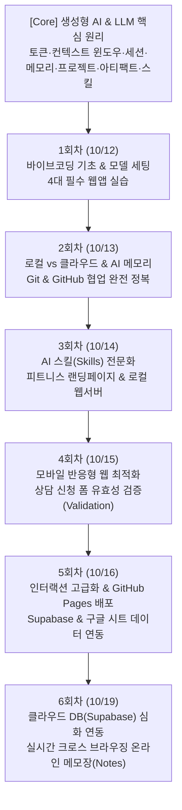

# 🚀 AI 바이브코딩 실무 2차 과정 완벽 실습 가이드북 (CoreMate LMS 연계)

> **공식 교육 플랫폼**: [코어메이트 LMS (class.coremate.kr/learn/ai-agent-course-2)](https://class.coremate.kr/learn/ai-agent-course-2)  
> **과정명**: AI 바이브코딩 실무 양성과정 2차 · 코딩 없이 내 웹앱 만들기  
> **강사**: 전종훈 (이그나이트 CTO)  
> **유튜브 플레이리스트**: [PLTeASr1UUXrs](https://www.youtube.com/playlist?list=PLTeASr1UUXrs)  
> **학습 대상**: 프로그래밍을 전혀 모르는 비전공자, 기획자, 마케터, 예비 창업자부터 실무 AI 에이전트와 웹앱을 직접 제작·배포하고 싶은 실무자까지  
> **작성 원칙**: 전문 개발 용어는 누구나 이해할 수 있는 일상 비유와 괄호 설명으로 풀었으며, 강의 영상이나 별도 교재 없이 이 가이드북만 보고도 100% 실습을 완료할 수 있도록 구성되었습니다.

---

## 📑 전체 교육 커리큘럼 한눈에 보기



---

## 🧠 [Core 기초] CoreMate 공식 AI 핵심 원리 & 개념 마스터

코딩 없이 AI와 성공적으로 협업하기 위해 반드시 알아야 할 9가지 핵심 원리입니다.

### 1. 생성형 AI와 LLM (대형 언어 모델)
* **생성형 AI (Generative AI)**: 기존 데이터를 분석만 하던 인공지능을 넘어, 텍스트·코드·이미지·영상 등 새로운 창작물을 직접 만들어내는 AI 기술.
* **LLM (Large Language Model)**: 수조 개의 인터넷 문장을 학습하여 인간의 말을 이해하고 다음 단어를 가장 자연스럽게 예측하여 답변을 작성하는 거대한 언어 두뇌.

### 2. 세션(Session)이란?
* **세션 (Session)**: 브라우저나 데스크톱 앱에서 AI와 주고받는 ‘하나의 대화 창(채팅방) 단위’.
* 채팅창을 새로 열면 새 세션이 시작되며, 기본적으로 각 세션은 서로 독립되어 이전 채팅방의 세부 대화가 섞이지 않습니다.

### 3. AI는 어떻게 앞 대화를 기억할까?
* AI는 사람처럼 뇌에 기억을 새겨두는 것이 아닙니다. 질문을 던질 때마다 **‘과거에 주고받은 대화 내역 전체를 이번 질문과 함께 한꺼번에 읽어들인 뒤’** 답변을 생성합니다.

### 4. 토큰 (Token) : AI가 글을 읽고 쓰는 단위
* **토큰 (Token)**: AI가 글을 이해하고 계산하는 최소 단위`(단어 또는 글자 조각)`. 영어는 대략 단어 하나당 1토큰, 한글은 글자 하나당 1~3토큰이 소모됩니다.
* **입력 토큰 vs 출력 토큰**:
  * *입력 토큰(Input Token)*: 내가 보낸 질문과 과거 대화 내역을 AI가 읽을 때 드는 비용/한도.
  * *출력 토큰(Output Token)*: AI가 화면에 코드를 타이핑하며 글을 출력할 때 드는 비용/한도.
* **토큰 쿼터(한도)**: ChatGPT Plus나 Claude Pro 같은 유료 플랜도 ‘3시간당 몇 회 질문/토큰 한도’가 정해져 있으므로, 코드를 생성할 때는 낭비 없이 핵심만 주고받아야 합니다.

### 5. 컨텍스트 윈도우 (Context Window)
* **컨텍스트 윈도우**: AI가 한 세션(대화방)에서 한꺼번에 머릿속에 담을 수 있는 ‘최대 읽기 용량(대화 기억 폭)’.
* **대화가 길어지면 앞부분을 놓치는 이유**: 대화가 책 수백 페이지 분량으로 길어져 컨텍스트 윈도우 한도를 넘어서면, AI는 가장 오래된 대화부터 잘라내거나 요약하여 기억하므로 초반에 내렸던 중요한 지시사항을 깜빡하게 됩니다.

### 6. 프로젝트 (Projects)와 아티팩트 (Artifacts)
* **프로젝트 (Project)**: 특정 목표(예: 빵집 창업 웹사이트)에 필요한 참고 문서, 가이드라인, 코드 파일들을 한곳에 묶어 보관하는 독립 작업 공간.
* **아티팩트 (Artifacts)**: 대화창 한구석에 코드가 파묻히지 않고, 화면 오른쪽에 독립된 창으로 깔끔하게 분리되어 실시간 웹 화면이나 긴 문서를 곧바로 렌더링해서 보여주는 전용 결과물 패널.

### 7. 사용자 지정 확장: 스킬(Skills), 커넥터(Connectors), 플러그인(Plugins)
* **스킬 (Skills)**: AI에게 전문 UI 디자이너나 전문 마케터처럼 일관된 작업 표준과 노하우를 주입하는 지침 모듈.
* **커넥터 (Connectors) & 플러그인 (Plugins)**: AI가 혼자 작업하는 것을 넘어, GitHub 저장소, 구글 드라이브, Notion, Supabase 같은 외부 인터넷 서비스와 직접 통신할 수 있도록 연결해 주는 다리.

### 8. 클라우드 컴퓨터 vs 내 컴퓨터 (로컬)
* **클라우드 (Cloud)**: 오픈AI나 앤스로픽 본사의 인터넷 서버. 브라우저에서만 대화하면 코드가 인터넷 화면에만 떠 있고 내 컴퓨터 하드디스크에는 저장되지 않습니다.
* **로컬 (Local)**: 내 눈앞의 노트북/데스크톱 본체. 내 컴퓨터 폴더에 저장해야 인터넷이 끊겨도 파일이 안전하게 보존되고 실제 소프트웨어로 구동됩니다.
* **왜 브라우저와 데스크톱 앱에서 같은 대화가 보일까?**: 모든 대화 텍스트가 중앙 클라우드 데이터베이스에 실시간 저장되어, 내 계정으로 로그인한 모든 기기(스마트폰, 앱, 웹 브라우저)에 1초 만에 동기화되기 때문입니다.

### 9. AI 도구의 진화 (챗 ➔ 코드 ➔ 코워크)
* 초기에는 단순 질문답변용 **챗(Chat)**이었으나, 점차 내 컴퓨터 폴더의 파일을 직접 만들고 수정하는 **코드/코덱스(Codex)** 모드로 발전하였으며, 현재는 여러 AI 에이전트와 도구가 유기적으로 협업하는 **코워크(Co-work)** 체제로 통합되고 있습니다.

---

## 📅 [1회차] 바이브코딩 첫걸음 & 4대 웹 인터랙션 실습 (10월 12일)

### 🎯 1회차 학습 목표
* 코딩 문법을 직접 타이핑하지 않고, AI에게 자연어 프롬프트`(작업 지시문)`를 전달하여 단일 파일(`index.html`)로 동작하는 4가지 웹앱을 완성합니다.
* AI 데스크톱 앱의 코덱스`(Codex, 컴퓨터 폴더 연동 코딩 모드)` 환경과 최적 모델 설정을 익힙니다.

### 💡 1회차 알기 쉬운 용어 사전
* **바이브코딩 (Vibe Coding)**: 복잡한 문법 대신, 느낌과 목적을 대화하듯 AI에게 전달해 소프트웨어를 완성하는 새로운 개발 방식.
* **루나 모델 (Luna)**: 전종훈 강사가 적극 추천한 가성비 모델. 비싼 GPT-4o 대비 이용량 한도`(토큰 쿼터)`를 크게 아끼면서 빠른 속도와 높은 코딩 정확도를 냄.
* **index.html**: 웹 브라우저가 폴더를 열었을 때 가장 먼저 찾아 읽는 대문이자 첫 번째 기본 웹 문서.
* **CDN (콘텐츠 전송 네트워크)**: 프로그램을 컴퓨터에 복잡하게 설치하지 않고, 웹 주소 링크 한 줄만 코드에 넣으면 인터넷에서 부품을 즉시 빌려와 쓸 수 있게 해주는 연결 방식.

---

### 🛠️ 1회차 4대 필수 실습 가이드

#### 실습 1. 내 컴퓨터에서 열리는 빵집 랜딩 페이지 (`index.html`)
* **목표**: 파일 더블클릭 한 번으로 내 브라우저에서 바로 열리는 따뜻한 분위기의 빵집 홍보 페이지 만들기.
* **따라 하기 단계**:
  1. 바탕화면에 `bakery`라는 이름의 새 폴더를 만듭니다.
  2. ChatGPT 데스크톱 앱에서 작업 폴더를 `bakery` 폴더로 연결합니다.
  3. 모델을 **루나(Luna)**, 추론 강도를 **하이(High)**로 맞춥니다.
  4. 아래 프롬프트를 전송합니다.
  5. 폴더에 생성된 `index.html` 파일을 더블클릭하여 크롬 브라우저에서 확인합니다.
* **실전 프롬프트**:
```text
당신은 감성적인 웹 디자이너입니다.
단 하나의 파일(index.html)로 실행되는 따뜻한 동네 베이커리 '달콤한 오후'의 홍보 웹페이지를 만들어주세요.
- 베이지와 브라운 톤의 부드럽고 따뜻한 색감
- 상단 내비게이션(홈, 메뉴, 오시는 길), 대표 빵 3가지(크루아상, 소금빵, 바게트) 카드 섹션
- 외부 프로그램 설치 없이 파일 더블클릭만으로 브라우저에서 바로 열리도록 완성된 코드를 index.html로 저장해주세요.
```

#### 실습 2. 주석으로 한 가지 이상 바꾼 나만의 게임
* **목표**: AI가 코드에 달아준 설명글`(주석, Comments)`을 찾아보고, 숫자 하나만 바꿔서 나만의 게임 규칙 만들기.
* **따라 하기 단계**:
  1. 바탕화면에 새 폴더 `my-game`을 만들고 폴더를 연결합니다.
  2. 아래 프롬프트를 전송해 주석 안내문이 포함된 미니게임을 만듭니다.
  3. 완성된 `index.html` 파일을 우클릭하여 **[메모장]** 또는 텍스트 편집기로 엽니다.
  4. 상단의 `// [초보자 수정 포인트]` 부분을 찾아 공 속도, 막대기 크기, 목숨 숫자 중 하나를 변경합니다.
  5. `Ctrl + S`(맥은 `Cmd + S`)로 저장하고 브라우저를 새로고침(`F5`)하여 규칙이 바뀐 게임을 플레이합니다.
* **실전 프롬프트**:
```text
브라우저에서 바로 마우스나 방향키로 즐길 수 있는 미니 게임(벽돌깨기 또는 장애물 피하기)을 index.html 단일 파일로 만들어주세요.
초보자가 코드를 열어서 쉽게 룰을 바꿀 수 있도록, 파일 상단에 아래와 같이 명확한 한글 주석을 달아주세요:
// [초보자 수정 가이드]
// 1. 공 이동 속도 조절: SPEED = 5
// 2. 패들(막대기) 가로 크기: PADDLE_WIDTH = 100
// 3. 목숨 개수: LIVES = 3
```

#### 실습 3. 마우스로 돌려볼 수 있는 3D 태양계
* **목표**: 마우스 드래그로 360도 입체 회전하고 휠로 확대/축소할 수 있는 3D 가상 우주 공간 만들기.
* **따라 하기 단계**:
  1. 새 폴더 `solar-system`을 만들고 폴더를 연결합니다.
  2. Three.js CDN 라이브러리를 연동하는 프롬프트를 전송합니다.
  3. 생성된 `index.html`을 브라우저로 열고 마우스 좌클릭 드래그로 시점을 돌려보며 행성들의 궤도를 관찰합니다.
* **실전 프롬프트**:
```text
Three.js CDN 라이브러리를 사용해서, 브라우저 화면 가득 마우스로 360도 자유롭게 돌려보고(OrbitControls) 줌인/아웃할 수 있는 '3D 태양계 시뮬레이션'을 index.html로 만들어주세요.
- 중앙의 빛나는 태양과 그 주위를 도는 행성들(수성, 금성, 지구, 화성, 목성, 토성)
- 행성마다 고유한 색상과 자전/공전 애니메이션 적용
- 우주 배경에 반짝이는 별빛 파티클 효과 추가
```

#### 실습 4. 손가락으로 허공에 그린 그림 (`허공그림.png`)
* **목표**: 웹캠으로 검지손가락 끝의 움직임을 실시간 감지하여 허공에 그림을 그리고, 그린 그림을 이미지 파일로 저장하기.
* **따라 하기 단계**:
  1. 새 폴더 `air-drawing`을 만들고 폴더를 연결합니다.
  2. MediaPipe Hands 라이브러리를 연동하는 프롬프트를 전송합니다.
  3. 브라우저에서 `index.html`을 열고, 브라우저 상단에서 **[카메라 권한 허용]**을 클릭합니다.
  4. 웹캠 앞에 손을 들고 검지손가락을 세워 허공에 글씨나 그림을 그립니다.
  5. 화면 오른쪽의 **[그림 저장하기]** 버튼을 눌러 내 컴퓨터에 `허공그림.png` 파일로 다운로드합니다.
* **실전 프롬프트**:
```text
웹캠을 통해 사용자의 손동작을 인식해서 허공에 그림을 그릴 수 있는 인터랙티브 웹앱을 index.html로 만들어주세요.
- 구글 MediaPipe Hands 라이브러리(CDN) 사용
- 8번 랜드마크(검지손가락 끝) 위치를 추적하여 캔버스에 매끄러운 궤적 선 그리기
- 화면에 [색상 선택], [선 굵기], [전체 지우기], [허공그림.png 다운로드] 버튼 구현
- 브라우저를 띄우고 카메라 권한만 허용하면 누구나 쉽게 쓸 수 있도록 친절한 안내 문구를 화면에 표시해주세요.
```

---

## 📅 [2회차] 로컬 환경 & AI 메모리 & Git·GitHub 완전 정복 (10월 13일)

### 🎯 2회차 학습 목표
* 클라우드와 내 컴퓨터 로컬 환경의 차이를 이해하고, ChatGPT 3단계 메모리를 체계적으로 제어합니다.
* 깃(Git)과 깃허브(GitHub)의 근본적 차이와 저장소(Repository) 개념을 마스터하고, AI와 함께 버전 관리(스테이징, 커밋, 브랜치, 롤백)를 실습합니다.

### 💡 2회차 알기 쉬운 용어 사전
* **Git (깃)**: 내 컴퓨터 안에서 코드의 변경 이력을 타임머신처럼 기록해 주는 개인 기록 장부.
* **GitHub (깃허브)**: 깃으로 기록한 장부와 프로젝트 파일을 인터넷 클라우드에 올려 다른 사람과 공유하고 협업할 수 있는 전 세계 최대의 온라인 저장소 플랫폼.
* **작업 폴더(Working Tree) vs 스테이징(Staging) vs 커밋(Commit)**:
  * *작업 폴더*: 지금 내가 파일을 고치고 있는 내 컴퓨터 폴더.
  * *스테이징*: 이번에 기록으로 남길 파일들만 골라 무대(Stage) 위에 올려두는 준비 작업.
  * *커밋*: 무대에 오른 파일들의 상태를 "00기능 추가 완료"라는 설명표와 함께 영구히 박제하는 타임머신 스냅샷.
* **브랜치 (Branch) & 병합 (Merge)**:
  * *브랜치*: 원본 코드를 망치지 않고 새로운 기능을 안전하게 실험하기 위해 만들어내는 독립된 작업 나뭇가지.
  * *병합*: 브랜치에서 완성한 새 기능을 원본 줄기(main)에 합치는 과정.
* **GitHub 5대 협업 도구**:
  * *README*: 프로젝트를 처음 방문한 사람을 위한 소개 설명서.
  * *Issues*: 버그 신고나 새로운 작업 목록을 등록하는 일감 티켓.
  * *Projects*: 할 일, 진행 중, 완료를 한눈에 보는 칸반 보드.
  * *Pull Request (PR)*: 내가 작업한 브랜치를 원본에 합쳐달라고 검토를 요청하는 제안서.
  * *GitHub Actions*: 코드가 올라오면 테스트나 배포를 스스로 알아서 실행하는 자동화 로봇.

---

### 🛠️ 2회차 초보자 실습 단계

#### 실습 1. ChatGPT 메모리 정리 & 프로젝트 지침 파일(`.chatgpt-rules`) 설정
* ChatGPT 설정 ➔ [개인화] ➔ [메모리 관리]에서 코딩과 무관한 과거 잡담을 정리합니다.
* 앞으로 작업할 폴더에 AI가 무조건 따라야 할 작업 원칙을 프롬프트로 심어줍니다.
```text
앞으로 이 프로젝트 폴더 안에서 작업할 때는 다음 원칙을 항상 지켜줘:
1. 초보자가 코드를 쉽게 이해할 수 있도록 중요한 기능마다 친절한 한글 주석을 달아줄 것.
2. 복잡한 패키지 설치 없이 브라우저 더블클릭만으로 열리는 단일 HTML 파일 구조를 유지할 것.
3. 디자인은 모던하고 깔끔한 Tailwind CSS 스타일을 적용할 것.
이 내용을 이 프로젝트의 기본 작업 지침으로 기억해줘.
```

#### 실습 2. AI에게 Git 맡겨 저장소 초기화 & 첫 커밋 만들기
* **AI 프롬프트**:
```text
현재 작업 폴더에서 Git 버전 관리를 시작하고 싶습니다.
1. Git 저장소를 초기화(git init)해주세요.
2. 초보자를 위해 프로젝트의 목적과 파일 구성을 설명하는 친절한 README.md 문서를 작성해주세요.
3. 모든 파일을 스테이징(git add .)하고 첫 번째 커밋("feat: 프로젝트 초기화 및 빵집 웹페이지 생성")을 작성해주세요.
4. 방금 수행된 깃 로그(git log) 상태를 한글로 쉽게 요약해서 설명해주세요.
```

#### 실습 3. 기능 브랜치 생성 및 안전한 병합(Merge)
* **AI 프롬프트**:
```text
새로운 디자인을 안전하게 시험해보고 싶습니다:
1. 'feature/dark-mode'라는 이름의 새로운 브랜치를 생성하고 이동해주세요.
2. 웹페이지의 배경을 다크 모드로 변경한 뒤 변경 사항을 확인(diff)해주세요.
3. 변경 사항을 'feat: 다크모드 디자인 추가'라는 메시지로 커밋해주세요.
4. 다시 메인(main) 브랜치로 돌아와 방금 작업한 다크모드 브랜치를 안전하게 병합(merge)해주세요.
```

---

## 📅 [3회차] AI 스킬(Skills) 장착 & 피트니스 랜딩페이지 (10월 14일)

### 🎯 3회차 학습 목표
* AI에게 전문 직무 능력(UI/UX 디자이너, 마케팅 카피라이터)을 장착시키는 **스킬(Skills) 개념**을 마스터합니다.
* 실제 고객이 상담 신청 버튼을 누르고 싶어지는 고품질 피트니스 센터 랜딩페이지를 제작합니다.
* 로컬 정적 웹 서버(Local Web Server)를 구동하여 실제 웹 환경처럼 테스트합니다.

### 💡 3회차 알기 쉬운 용어 사전
* **스킬 (Skills)**: 스마트폰에 앱을 깔듯, AI 에이전트에게 전문 디자인 규칙이나 광고 카피 작성 공식 같은 특별한 기술을 장착해 주는 확장 모듈.
* **랜딩 페이지 (Landing Page)**: 고객이 광고나 링크를 누르고 가장 먼저 착륙`(Landing)`하여, 브랜드 소개를 읽고 최종적으로 '상담 예약'이나 '구매' 버튼을 누르도록 유도하는 단일 페이지 웹사이트.
* **정적 웹 서버 (Local Web Server)**: 내 컴퓨터 안에 작은 간이 방송국을 차려서 브라우저에서 실제 인터넷에 올라간 것처럼 웹을 띄워주는 도구.

---

### 🛠️ 3회차 초보자 실습 단계
```text
당신은 최고급 프리미엄 피트니스 클럽의 수석 마케터이자 UI 디자이너입니다.
신규 회원을 유치하기 위한 모던한 헬스장 랜딩페이지를 index.html 단일 파일로 만들어주세요.
- 강렬하고 세련된 다크 모드(블랙 & 형광 네온 포인트) 디자인
- 시선을 사로잡는 강렬한 헤드카피 ("당신의 한계를 넘어서는 1:1 맞춤 트레이닝")
- 프로그램 안내 3종(PT, 필라테스, 체형교정)과 트레이너 프로필 카드
- 하단 무료 체형분석 1회 체험 상담 신청 폼(이름, 연락처, 희망시간 입력란)
```

---

## 📅 [4회차] 모바일 반응형 웹 & 폼 유효성 검증 (10월 15일)

### 🎯 4회차 학습 목표
* PC 모니터뿐만 아니라 스마트폰과 태블릿 화면에서도 비율이 깨지지 않는 **반응형 웹**을 구현합니다.
* 브라우저 개발자 도구(F12)의 모바일 디바이스 툴바로 다양한 스마트폰 화면을 디버깅합니다.
* 고객이 연락처를 빼먹거나 잘못 입력했을 때 친절하게 안내창을 띄우는 **폼 유효성 검사**를 구축합니다.

### 💡 4회차 알기 쉬운 용어 사전
* **반응형 웹 (Responsive Web)**: 화면 크기가 제각각인 스마트폰, 태블릿, PC 모니터에 맞춰 글자 크기와 카드 배치가 자동으로 딱 맞게 조절되는 기술.
* **미디어 쿼리 (Media Query)**: "화면 폭이 768px 이하로 좁아지면 가로 3열 카드를 세로 1단으로 재배치하라"와 같이 기기 화면 크기별로 스타일을 바꿔주는 CSS 규칙.
* **유효성 검사 (Validation)**: 고객이 이름을 비워두거나 전화번호 자리에 한글을 적었을 때, 시스템이 "올바른 연락처를 입력해주세요"라고 경고창을 띄워 잘못된 입력을 막아주는 안전장치.

---

### 🛠️ 4회차 초보자 실습 단계
```text
기존 피트니스 랜딩페이지에 다음 두 가지 필수 기능을 보강해주세요:

1. [모바일 반응형 최적화]
- 화면 폭이 768px 이하(모바일)로 좁아지면 가로 3개 나열 카드가 세로 1단으로 자연스럽게 떨어지도록 미디어 쿼리를 적용해주세요.
- 모바일에서 손가락으로 누르기 편하도록 버튼 터치 영역을 키워주세요.

2. [상담 신청 폼 유효성 검사]
- 이름이 빈칸이면 "이름을 입력해주세요" 경고 메시지 표시
- 전화번호가 한국 휴대전화 번호 형식(010-XXXX-XXXX)이 아니면 빨간색 안내 문구 표시
- 모든 입력이 올바를 때만 "상담 신청이 정상 접수되었습니다!"라는 확인 팝업 표시
```

---

## 📅 [5회차] 인터랙션 고급화 & GitHub Pages 배포 & 구글시트 연동 (10월 16일)

### 🎯 5회차 학습 목표
* 마우스 호버`(Hover)` 효과와 부드러운 스크롤 애니메이션으로 웹사이트의 완성도를 극대화합니다.
* GitHub Pages를 통해 전 세계 누구나 접속할 수 있는 인터넷 링크로 무료 배포하고 스마트폰으로 직접 확인합니다.
* **수퍼베이스(Supabase) & 구글 시트(Google Sheets) 활용 기초**: 코딩 없이 스프레드시트나 클라우드에 상담 신청 데이터를 자동으로 누적 저장하는 원리를 학습합니다.

### 💡 5회차 알기 쉬운 용어 사전
* **배포 (Deployment)**: 내 개인 컴퓨터를 꺼도 웹사이트가 꺼지지 않도록 24시간 돌아가는 인터넷 클라우드 서버에 프로그램을 올려 전 세계 누구나 접속할 수 있게 만드는 과정.
* **호스팅 (Hosting)**: 내 웹사이트 파일들이 인터넷 공간에 항상 머무를 수 있도록 집`(서버 컴퓨터 공간)`을 마련해 주는 서비스.
* **구글 시트 연동 (Google Sheets as DB)**: 상담 폼에 고객이 이름과 전화번호를 적고 [신청]을 누르면, 우리 회사 구글 드라이브 엑셀 시트에 한 줄씩 실시간으로 자동 입력되도록 연결하는 방식.

---

### 🛠️ 5회차 초보자 실습 단계

#### 1. 애니메이션 보강 프롬프트
```text
피트니스 랜딩페이지에 시각적인 고급스러움을 더해주세요:
1. 카드 위에 마우스를 올렸을 때 살짝 공중으로 떠오르는 부드러운 그림자 효과(Hover 효과) 추가
2. 화면을 아래로 스크롤하거나 메뉴를 눌렀을 때 각 섹션으로 부드럽게 미끄러지듯 이동하는 부드러운 스크롤(Smooth Scroll) 효과 적용
```

#### 2. GitHub Pages로 인터넷에 무료 배포하기
1. [github.com](https://github.com)에서 **[New repository]** 생성 (이름: `my-fitness`, Public 선택).
2. `uploading an existing file`을 눌러 `index.html` 파일을 드래그해 업로드 후 **[Commit changes]**.
3. 저장소 메뉴의 **[Settings] ➔ [Pages]**로 들어가 Branch를 `main`으로 설정하고 **[Save]**.
4. 1~2분 뒤 생성된 인터넷 주소(`https://아이디.github.io/my-fitness`)를 스마트폰 카카오톡으로 전송하여 모바일에서 직접 열어봅니다.

#### 3. 구글 시트 / Supabase 연동 상담 폼 원리
```text
상담 신청 폼의 데이터가 구글 스프레드시트나 Supabase 클라우드로 전송되는 시뮬레이션을 구현해주세요:
- 사용자가 신청서를 제출하면 로딩 스피너와 함께 "데이터를 클라우드로 전송 중..." 안내 표시
- 전송 완료 후 가상의 구글 시트 저장 완료 메시지와 함께 입력 필드 초기화
```

---

## 📅 [6회차] 클라우드 데이터베이스(Supabase) 심화 & 실시간 메모장 (10월 19일)

> **2주차 도약**: 1주차(프론트엔드/화면 구현)에서 벗어나, 데이터를 인터넷 중앙 금고에 안전하게 보관하고 다른 기기나 다른 사람과 실시간 공유되는 **진짜 백엔드 풀스택 개발**을 완성합니다!

### 🎯 6회차 학습 목표
* 브라우저 캐시나 로컬 스토리지의 한계`(기기를 바꾸면 내용이 날아감)`를 이해합니다.
* 무료 클라우드 BaaS인 **Supabase(수퍼베이스)**를 연동하여 CRUD`(생성/조회/수정/삭제)` 기능이 완전히 작동하는 실시간 온라인 메모장을 제작합니다.
* 크롬과 사파리, 스마트폰을 넘나드는 크로스 브라우징 실시간 동기화를 검증합니다.

### 💡 6회차 알기 쉬운 용어 사전
* **로컬 스토리지 vs 클라우드 DB**:
  * *로컬 스토리지*: 내 컴퓨터 브라우저 임시 메모장에 저장하는 방식 (컴퓨터를 바꾸거나 스마트폰으로 보면 아무것도 안 보임).
  * *클라우드 DB*: 인터넷 중앙 서버 금고에 보관하는 방식 (크롬에서 메모를 쓰면 사파리나 내 스마트폰에서도 1초 만에 똑같이 보임).
* **Supabase (수퍼베이스)**: 복잡한 서버 컴퓨터나 인프라 설정 없이, 웹에서 클릭 몇 번으로 엑셀 표처럼 생긴 데이터베이스와 로그인 기능을 무료로 제공해 주는 클라우드 백엔드 플랫폼.
* **CRUD (크루드)**: 모든 데이터 서비스의 4대 기본 동작인 생성`(Create)`, 읽기`(Read)`, 수정`(Update)`, 삭제`(Delete)`의 앞 글자를 딴 약어.
* **Project URL & anon Key**: Supabase 클라우드 금고의 고유한 인터넷 주소`(URL)`와, 우리 웹페이지가 금고에 접근할 수 있도록 열어주는 암호 열쇠`(Key)`.

---

### 🛠️ 6회차 초보자 실습 4단계

#### 1단계: Supabase 무료 가입 및 프로젝트 생성
1. [supabase.com](https://supabase.com)에 접속하여 무료 회원가입을 진행합니다 (GitHub 계정 연동 추천).
2. **[New Project]** 버튼을 클릭합니다.
3. 프로젝트 이름을 입력하고(예: `vibe-notes`), 지역`(Region)`을 **Seoul (`ap-northeast-2`)**로 선택합니다.
4. 비밀번호는 **[Generate a password]**를 눌러 안전하게 자동 생성한 뒤 복사해 둡니다.
5. **[Create new project]**를 누르고 1~2분 기다리면 클라우드 데이터베이스가 세팅됩니다.

#### 2단계: API 접속 주소(URL) 및 공개 키(Key) 복사
1. 왼쪽 사이드바 맨 아래의 **톱니바퀴 아이콘(Project Settings)**을 클릭합니다.
2. 메뉴 중 **[API]** 탭을 선택합니다.
3. 화면에 보이는 두 가지 값을 복사합니다:
   * **Project URL**: `https://xxxxxxxx.supabase.co`
   * **anon public key**: `eyJhbGciOiJIUzI1NiIsInR5cCI6...`

#### 3단계: ChatGPT에게 온라인 메모장 웹앱 제작 요청
새 폴더 `cloud-notes`를 만들고, 복사해 둔 URL과 키를 넣어서 프롬프트를 전송합니다.
* **실전 프롬프트**:
```text
Supabase CDN(@supabase/supabase-js)을 연동하여 실시간으로 데이터가 클라우드에 저장되는 '온라인 메모장(Notes)' 웹앱을 단일 파일(index.html)로 만들어주세요.

[Supabase 설정 정보]
- SUPABASE_URL: "여기에_본인의_Project_URL_붙여넣기"
- SUPABASE_ANON_KEY: "여기에_본인의_anon_public_key_붙여넣기"

[필수 기능]
1. 테이블명: 'notes' (id, title, content, created_at 컬럼)
2. CRUD 구현: 새 메모 작성(Create), 목록 실시간 조회(Read), 메모 삭제(Delete)
3. 만약 Supabase에 'notes' 테이블이 아직 없다면 생성할 수 있도록 테이블 생성 SQL 문을 주석으로 안내해주세요.
4. 테스트 편의를 위해 복잡한 이메일 인증 절차 없이 닉네임이나 바로 등록 형태로 동작하게 해주세요.
5. Tailwind CSS를 사용해 깔끔하고 모던한 카드형 메모 UI로 구성해주세요.
```

#### 4단계: 실시간 동기화 검증 (크로스 브라우징)
1. 생성된 `index.html`을 **크롬(Chrome) 브라우저**에서 엽니다.
2. 새 메모로 `"첫 번째 클라우드 메모 테스트!"`를 입력하고 저장합니다.
3. 동일한 `index.html` 파일을 **사파리(Safari)나 엣지(Edge) 브라우저**로 새로 엽니다.
4. 사파리 화면에서도 방금 크롬에서 작성한 메모가 그대로 떠 있는 것을 확인합니다!
5. Supabase 관리자 페이지의 **[Table Editor]** 메뉴로 들어가면, 내가 웹 화면에서 쓴 글이 엑셀 표처럼 서버 DB에 차곡차곡 저장된 것을 직접 눈으로 확인할 수 있습니다.

---

### ❓ 초보자 트러블슈팅 가이드
* **문제: 테이블 없음 오류 (`relation "notes" does not exist`)**
  * **해결**: Supabase 대시보드 ➔ [SQL Editor] ➔ 아래 쿼리를 입력하고 [Run] 클릭.
```sql
CREATE TABLE notes (
  id BIGSERIAL PRIMARY KEY,
  title TEXT NOT NULL,
  content TEXT,
  created_at TIMESTAMPTZ DEFAULT NOW()
);
```
